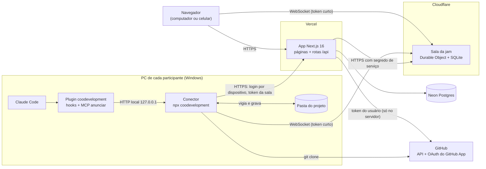
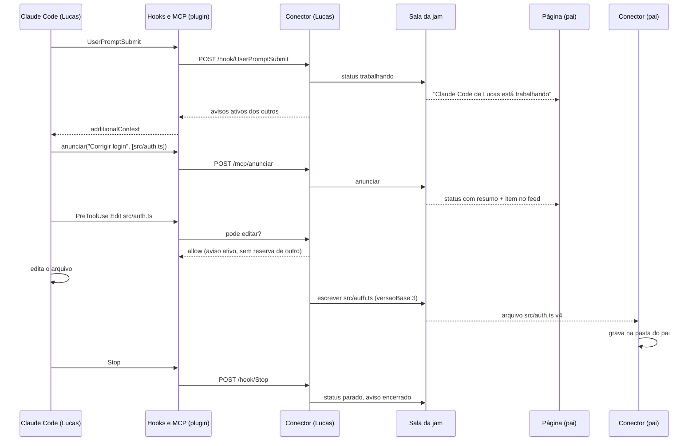
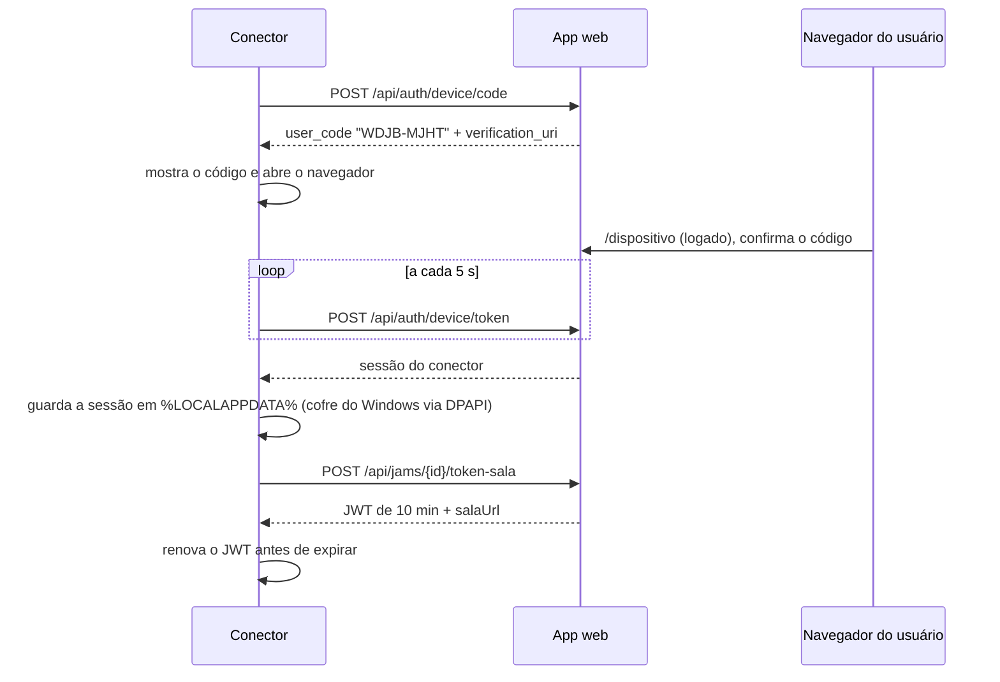
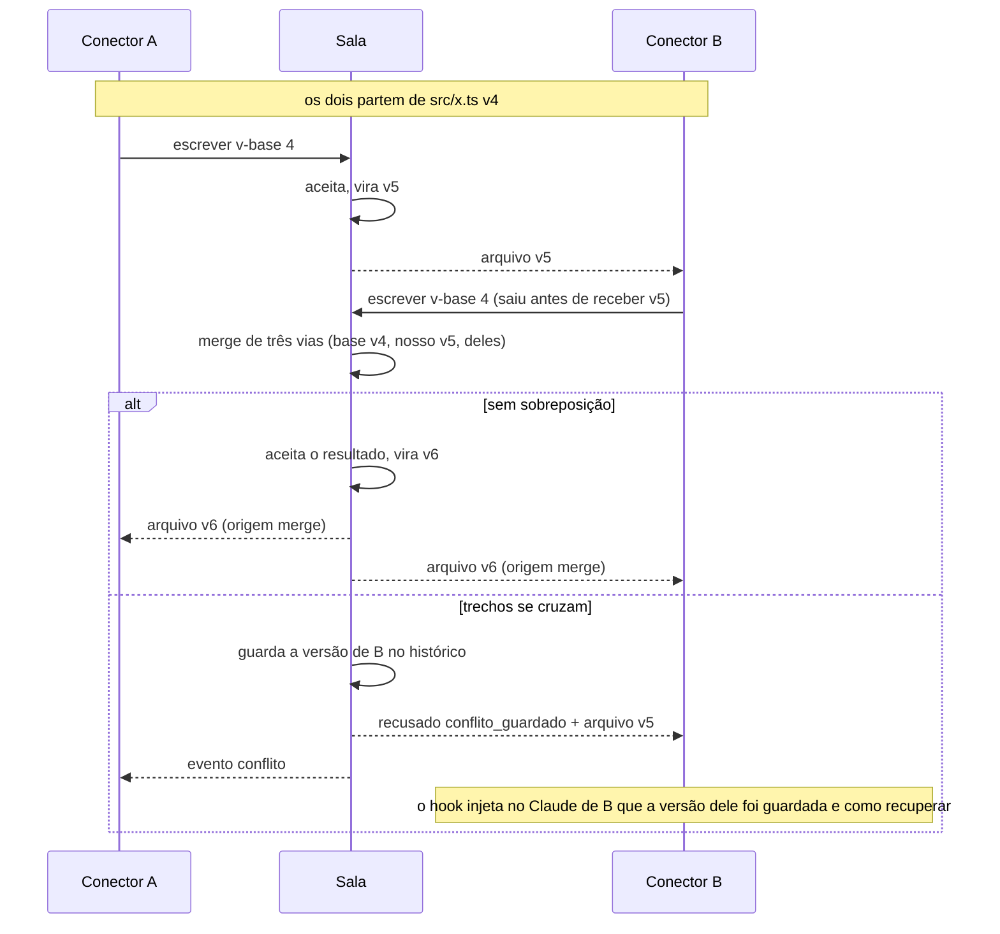
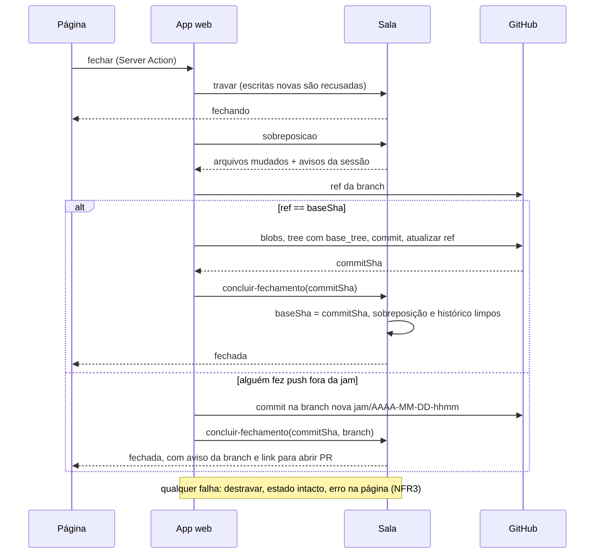
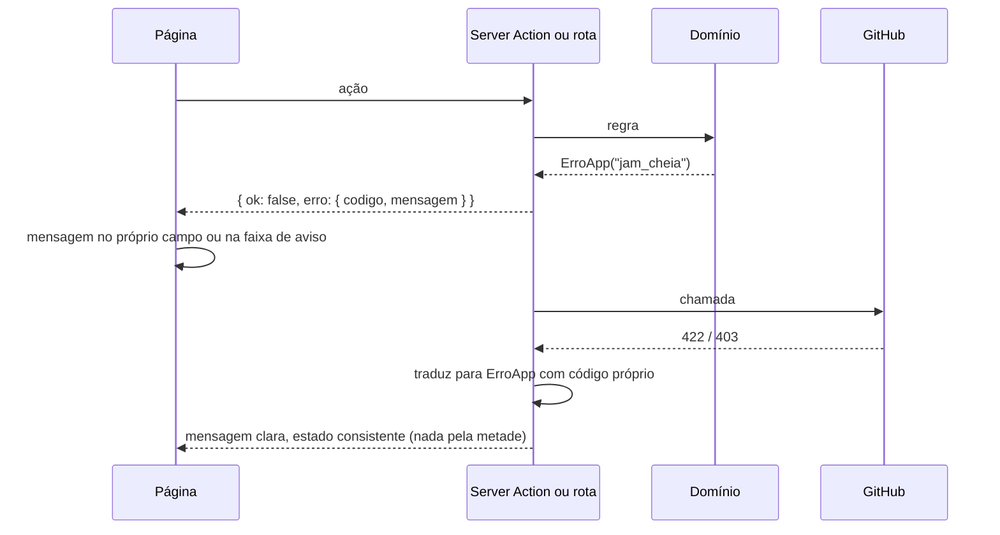

# Coodevelopment Fullstack Architecture Document

Template `fullstack-architecture-tmpl.yaml` v2.0, gerado em modo YOLO a pedido
do Lucas ("ok pode mandar bala") em 2026-10-23. Base: `docs/prd.md` 0.2,
`docs/front-end-spec.md` 0.2, `docs/brief.md` 1.1, `docs/decisoes.md` e as
pesquisas em `docs/research/`. Escolhas que ainda precisam ser provadas na
prática estão marcadas **[verificar]**, com a story onde a prova acontece.

## Introduction

Este documento descreve a arquitetura completa do Coodevelopment: o app web,
a sala de tempo real, o conector que roda no PC de cada participante e o
plugin do Claude Code, e como eles conversam. É a fonte única para o
desenvolvimento feito com agentes.

O Coodevelopment não é um app web comum: metade do sistema roda no PC de cada
pessoa (D10). Por isso a arquitetura tem quatro partes que precisam ficar em
acordo, e um pacote de protocolo compartilhado garante isso.

### Starter Template or Existing Project

N/A, projeto greenfield. Nenhum starter de terceiros. O app web segue o preset
AIOX `nextjs-react` citado no PRD (Next.js, React, TypeScript, Tailwind), e a
sala segue o exemplo oficial do PartyServer. Nada vem de outro projeto do
Lucas (D11: o sistema não é desenhado para nenhum projeto específico).

### Change Log

| Date | Version | Description | Author |
|---|---|---|---|
| 2026-10-23 | 0.1 | Primeira versão, modo YOLO, a partir do PRD 0.2 | Aria (@architect), via Claude |
| 2026-10-23 | 0.2 | Validação do @po: sala no endereço `workers.dev`, porque o DNS de `lucas-andrade.dev` está na Vercel | Pax (@po), via Claude |

## High Level Architecture

### Technical Summary

O Coodevelopment é um sistema distribuído em quatro partes:

- **App web:** Next.js 16 na Vercel, com Postgres no Neon. Cuida de login,
  amigos, jams, GitHub e commit.
- **Sala da jam:** um Durable Object da Cloudflare por jam, escrito com
  PartyServer. É o centro de tempo real: presença, status dos Claudes, feed e
  o estado atual dos arquivos, guardado no SQLite da própria sala.
- **Conector:** um processo Node que cada participante roda com `npx` no
  próprio PC. Vigia a pasta do projeto, troca arquivos com a sala e atende os
  hooks do Claude Code localmente.
- **Plugin do Claude Code:** instalado pelo conector, com hooks em Node e um
  servidor MCP com a ferramenta `anunciar`.

O app web emite tokens curtos para o navegador e para o conector entrarem na
sala. O token do GitHub nunca sai do servidor da Vercel (NFR8). Ao fechar a
jam, o app lê da sala os arquivos mudados e faz o commit pela API do GitHub,
em cima do commit de partida.

Os objetivos do PRD se cumprem assim:

- **Tempo real (NFR1, NFR2):** conexão aberta direto entre conector e sala,
  sem passar pela Vercel.
- **Nada se perde (NFR3, FR21):** o estado mora na sala, não nos PCs.
- **Qualquer stack (NFR13):** a sincronização trabalha com arquivos e com o
  `.gitignore` do projeto, nunca com linguagem, framework ou banco.

### Platform and Infrastructure Choice

Opções avaliadas (pesquisa de 23/10/2026):

| Opção | Prós | Contras |
|---|---|---|
| **Vercel + Neon + Cloudflare Durable Objects** | Mensagem de até 32 MiB (arquivo de 1 MB vai inteiro); lógica e SQLite por sala; reconexão pronta no cliente `partysocket`; plano gratuito cobre 2 ou 3 pessoas | Segundo deploy (`wrangler`) ao lado da Vercel |
| Vercel + Neon + Liveblocks | Presença e Yjs prontos | Plano gratuito de 3.000 min/mês (três pessoas gastam em cerca de 2 dias); mensagem de 1 MB; sem lógica no servidor |
| Vercel com WebSocket nativo + Upstash Redis | Tudo na Vercel | No Hobby a conexão cai a cada 300 s; presença e fan-out entre instâncias por nossa conta |
| Ably, Pusher, Supabase Realtime | Gerenciados | Mensagem de 10 KB a 256 KB obriga a fatiar arquivo; sem lugar para o estado da jam |

**Escolha: Vercel + Neon + Cloudflare Durable Objects (PartyServer).** É a
única que guarda o estado da jam junto da conexão (FR21) sem custo (NFR11) e
sem fatiar arquivos.

**Platform:** Vercel (app web), Cloudflare Workers com Durable Objects (sala),
Neon (Postgres), GitHub (repositórios e login)
**Key Services:** Vercel Functions, Neon Postgres, Cloudflare Durable Objects
com SQLite, GitHub App, npm (distribuição do conector)
**Deployment Host and Regions:** Vercel `gru1` (São Paulo) para as funções;
Neon `sa-east-1`; Durable Objects com dica de localização `sam` (América do
Sul) **[verificar na Story 2.4]**

### Repository Structure

**Structure:** monorepo
**Monorepo Tool:** pnpm workspaces (sem Turborepo; quatro pacotes não pedem
cache de build)
**Package Organization:** dois apps publicados (web e sala), um pacote
publicado no npm (conector, que carrega o plugin) e um pacote interno de
protocolo, importado pelos outros três.

### High Level Architecture Diagram



### Architectural Patterns

- **Sala autoritativa por jam:** um Durable Object por jam é a única fonte da
  verdade dos arquivos em andamento, da presença e do feed. _Rationale:_ um
  único processo ordena as escritas de cada jam, o que torna a detecção de
  conflito simples e confiável.
- **Base mais sobreposição:** a sala guarda só o commit de partida (`baseSha`)
  e os arquivos que mudaram desde ele, nunca o repositório inteiro.
  _Rationale:_ fica leve com repositório de qualquer tamanho e transforma o
  fechamento num commit direto (base + sobreposição).
- **Controle de concorrência otimista por arquivo:** cada escrita informa a
  versão em que se baseou; se a versão da sala andou, a sala tenta juntar as
  duas (merge de três vias). _Rationale:_ os avisos e as reservas tornam
  conflito raro, então não vale o custo de um editor colaborativo (CRDT).
- **Conector como ponte local:** hooks e MCP falam só com o conector em
  `127.0.0.1`; só o conector fala com a internet. _Rationale:_ hooks rápidos e
  independentes de rede (NFR5) e um só lugar com credenciais no PC.
- **Protocolo tipado compartilhado:** mensagens definidas uma vez em
  `packages/protocolo` com schemas zod e validadas nas duas pontas.
  _Rationale:_ quatro partes evoluindo juntas; erro de formato vira erro de
  compilação ou de validação, nunca comportamento silencioso.
- **Server Components e Server Actions no app web:** páginas renderizadas no
  servidor, mutações por Server Actions, e o tempo real só na página da jam.
  _Rationale:_ menos JavaScript no cliente e o token do GitHub sempre no
  servidor.
- **Tokens curtos para a sala:** o app emite um JWT de 10 minutos por jam e
  por pessoa; a sala só valida. _Rationale:_ a sala não acessa o banco nem
  guarda segredo de usuário.

## Tech Stack

Versões fixadas na Story 1.1 em 26/10/2026: o número exato é o que está no
`pnpm-lock.yaml`. Itens que a 1.1 ainda não instala aparecem com "fixar ao
instalar" e a última estável do dia, só como referência; a story que os
trouxer fixa a versão e atualiza esta tabela. Licenças conferidas no npm em
26/10/2026: todas MIT ou Apache 2.0, menos o PartyServer, que é ISC
(permissiva, equivalente à MIT). Better Auth e o SDK MCP foram conferidos em
outubro e entram nas Stories 1.2 e 4.x.

### Technology Stack Table

| Category | Technology | Version | Purpose | Rationale |
|---|---|---|---|---|
| Frontend Language | TypeScript | 6.0.3 (Apache-2.0) | Tudo, nas quatro partes | Um idioma só; tipos do protocolo compartilhados |
| Frontend Framework | Next.js (App Router) | 16.4.3 (MIT) | App web | Decisão do brief; Vercel; Server Components |
| UI Component Library | Radix UI Primitives (pacote `radix-ui`) | 1.8.1 (MIT) | Diálogo, menu, seletor acessíveis | Front-end spec: primitivos sem estilo, visual próprio |
| State Management | React (estado local) + `useSyncExternalStore` sobre a conexão da sala | React 19.3.0 (MIT) | Estado ao vivo da página da jam | Só uma página tem estado ao vivo; biblioteca de estado não se paga |
| Backend Language | TypeScript em Node.js | Node 22 LTS ou mais novo | Rotas, conector, plugin | `WebSocket` nativo no Node 22; o conector exige Node (D13) |
| Backend Framework | Next.js Route Handlers e Server Actions; PartyServer na sala | Next.js 16.4.3; PartyServer 0.5.10 (ISC) | API do app e lógica da sala | Sem servidor próprio para manter |
| API Style | REST (Route Handlers) + mensagens WebSocket tipadas | n/a | Conector e sala; mutações da UI por Server Actions | REST é o que o conector consome com `fetch`; WebSocket para o tempo real |
| Database | Neon Postgres + Drizzle ORM | Postgres 17; `drizzle-orm` 0.45.4 (Apache-2.0), `drizzle-kit` 0.31.11 (MIT), `@neondatabase/serverless` 1.2.0 (MIT) | Usuários, amizades, jams, participantes, fechamentos | Já usado pelo Lucas; SQL tipado |
| Cache | Nenhum | n/a | n/a | Escala de 2 ou 3 pessoas |
| File Storage | SQLite do Durable Object | n/a | Estado dos arquivos da jam, histórico e feed | Mora junto da conexão; limite de 5 GB no plano gratuito |
| Authentication | Better Auth com GitHub (via GitHub App) e plugin de device authorization | 1.7.13 (MIT) | Login web e login do conector por código | Auth.js está em manutenção desde 09/2025 e o time recomenda Better Auth; device flow (RFC 8628) pronto |
| GitHub API | `@octokit/rest` | 22.0.1 (MIT) | Chamadas ao GitHub em nome do usuário | Hook antes de cada chamada busca o token pelo Better Auth, que renova o vencido (Story 1.2) |
| Frontend Testing | Vitest + Testing Library | Vitest 4.1.12, `@testing-library/react` 16.3.3 (MIT) | Componentes e lógica de UI | Rápido, TypeScript nativo |
| Backend Testing | Vitest; `@cloudflare/vitest-plugin` na sala (o antigo `vitest-pool-workers`, renomeado) | Vitest 4.1.12, `@cloudflare/vitest-plugin` 1.4.7 (MIT) | Protocolo, sincronização, rotas, sala | Testa o Durable Object no runtime real |
| Database Testing | PGlite (`@electric-sql/pglite`), Postgres em WASM, com o migrador do Drizzle | 0.5.9 (Apache-2.0), só nos testes | Regras do app contra Postgres de verdade, com as migrações de `apps/web/drizzle` (Story 1.3) | Testa checks, unique e CTEs sem tocar no Neon e sem branch de teste |
| E2E Testing | Playwright (`@playwright/test`) | `@playwright/test` 1.64.1 (Apache-2.0); `@axe-core/playwright` 4.14.0 (MPL-2.0, só nos testes, não vai para o app) | Login simulado, criar jam, página da jam ao vivo | Padrão do mercado; roda no Windows |
| Build Tool | pnpm workspaces | pnpm 10.34.7 (MIT) | Monorepo | Já usado pelo Lucas |
| Bundler | Turbopack (web), Wrangler/esbuild (sala), tsup (conector) | Turbopack do Next.js 16.4.3; Wrangler 4.152.0 (MIT ou Apache-2.0); tsup 8.5.1 (MIT) | Build de cada parte | O padrão de cada plataforma |
| IaC Tool | `wrangler.jsonc` + configuração da Vercel por CLI | Wrangler 4.152.0; Vercel CLI pelo `npx` (65.2.0 em 26/10/2026) | Sala e app | Infra pequena; sem Terraform |
| CI/CD | GitHub Actions + integração Git da Vercel | n/a | Testes em PR; deploy da sala e publicação do conector | Vercel já publica na `main` |
| Monitoring | Vercel Observability + Cloudflare Workers Logs | n/a | Erros e latência | Incluídos nos planos |
| Logging | `console` estruturado (JSON) nas três partes de servidor; arquivo de log rotativo no conector | n/a | Diagnóstico | Lido pelo modo de diagnóstico do conector |
| CSS Framework | Tailwind CSS com tokens em CSS | 4.3.3 (MIT) | Visual da front-end spec | Tokens da paleta escura da spec (V3) e classes em `componentes/ui/estilo.ts` |
| Realtime | PartyServer + `partysocket` (Cloudflare) | PartyServer 0.5.10 (ISC); `partysocket` 1.3.0 (MIT), fixado na Story 2.5 | Sala da jam e clientes | Ver Platform Choice |
| MCP | `@modelcontextprotocol/server` (SDK v2) | 2.3.x (2.3.1 em 05/10/2026) | Servidor MCP `anunciar` | Linha estável atual; a v1 só recebe correções |
| Watcher | `@parcel/watcher` | fixar ao instalar; 2.6.0 em 26/10/2026 (MIT) | Vigiar a pasta do projeto | Nativo (ReadDirectoryChangesW no Windows), CPU baixa parada (NFR6) |
| Merge | `node-diff3` | fixar ao instalar; 3.2.1 em 26/10/2026 (MIT) | Merge de três vias na sala | Pequeno e sem dependência |
| Validação | zod | 4.6.7 (MIT) | Protocolo, rotas, entradas dos hooks | Standard Schema, aceito pelo SDK MCP v2 |

## Data Models

Dois lugares guardam dados, cada um com um papel:

- **Neon (app web):** quem é quem e o que existe: usuários, amizades, jams,
  participantes, fechamentos.
- **SQLite da sala (uma por jam):** o que está acontecendo: arquivos em
  andamento, histórico, avisos, feed, divergências.

Os tipos abaixo moram em `packages/protocolo/src/modelos.ts`.

### Usuario

**Purpose:** pessoa com conta, criada no primeiro login pelo GitHub (FR1).

**Key Attributes:**
- id: string - id interno (Better Auth)
- githubId: number - id numérico do GitHub, estável mesmo se o login mudar
- login: string - usuário do GitHub, usado na busca (FR2)
- nome: string - nome do perfil do GitHub, usado no status (D19)
- avatarUrl: string - foto do GitHub

#### TypeScript Interface

```typescript
export interface Usuario {
  id: string;
  githubId: number;
  login: string;
  nome: string; // cai para login quando o perfil não tem nome
  avatarUrl: string;
  criadoEm: string; // ISO 8601
}
```

#### Relationships

- Tem uma `account` do Better Auth com os tokens do GitHub (cifrados).
- Participa de várias jams; tem várias amizades e pedidos.

### Amizade e PedidoAmizade

**Purpose:** rede de amigos; só amigos podem ser chamados para uma jam (FR2,
FR6). Pedido cruzado vira aceite direto (front-end spec, confirmado).

**Key Attributes:**
- usuarioA, usuarioB: string - par guardado em ordem (`usuarioA < usuarioB`)
  para não duplicar
- de, para: string - quem pediu e quem recebeu
- status: "pendente" | "recusado"

#### TypeScript Interface

```typescript
export interface Amizade {
  usuarioA: string;
  usuarioB: string;
  criadaEm: string;
}

export interface PedidoAmizade {
  id: string;
  de: string;
  para: string;
  status: "pendente" | "recusado";
  criadoEm: string;
}
```

#### Relationships

- Aceitar um pedido apaga o pedido e cria a amizade, na mesma transação.

### Jam

**Purpose:** sala de trabalho ligada a um repositório do criador (D4).

**Key Attributes:**
- id: string - identificador curto e legível, usado no comando `npx`
- repoOwner, repoNome: string - repositório no GitHub
- criadorId: string - dono do repositório e do token que faz o commit
- estado: "aberta" | "fechando" | "fechada"
- baseSha: string - commit de partida da sessão atual

#### TypeScript Interface

```typescript
export type EstadoJam = "aberta" | "fechando" | "fechada";

export interface Jam {
  id: string; // ex.: "k7m2-rbq9" (sem caracteres ambíguos)
  nome: string;
  repoOwner: string;
  repoNome: string;
  branch: string; // branch padrão do repositório no momento da criação
  criadorId: string;
  estado: EstadoJam;
  baseSha: string;
  criadaEm: string;
  ultimoCommitEm: string | null;
}
```

#### Relationships

- Tem de 1 a 3 participantes (D6), um deles o criador.
- Tem vários fechamentos (um por commit feito).

### Participante

**Purpose:** ligação de um usuário a uma jam, com a situação no GitHub.

#### TypeScript Interface

```typescript
export interface Participante {
  jamId: string;
  usuarioId: string;
  papel: "criador" | "convidado";
  colaborador: "ok" | "pendente" | "falhou"; // convite do GitHub (Story 2.3)
  entrouEm: string;
}
```

#### Relationships

- Pertence a uma jam e a um usuário. A jam continua se o criador sair (D16):
  sair apaga o participante, mas o token do criador continua sendo usado no
  commit enquanto ele não revogar o app.

### Fechamento

**Purpose:** registro de cada commit feito ao fechar a jam (FR22, NFR3).

#### TypeScript Interface

```typescript
export interface Fechamento {
  id: string;
  jamId: string;
  fechadoPor: string;
  commitSha: string | null; // null enquanto o commit não terminou
  arquivos: number;
  status: "em_andamento" | "ok" | "falhou";
  erro: string | null;
  criadoEm: string;
}
```

### Modelos da sala (SQLite do Durable Object)

**Purpose:** estado ao vivo da jam, guardado junto da conexão.

#### TypeScript Interface

```typescript
// Um arquivo que mudou desde o baseSha. Arquivo sem registro = igual ao base.
export interface ArquivoJam {
  caminho: string; // relativo à raiz, sempre com "/"
  versao: number; // sobe a cada escrita aceita; 0 = conteúdo do baseSha
  hash: string; // sha256 do conteúdo normalizado (final de linha LF)
  apagado: boolean;
  binario: boolean;
  tamanho: number;
  autorId: string;
  avisoId: string | null; // aviso ativo do autor quando a escrita chegou
  atualizadoEm: string;
}

export interface Aviso {
  id: string;
  autorId: string;
  resumo: string; // vira o status (FR13)
  arquivos: string[]; // reservas (FR16)
  ativo: boolean; // termina no Stop do Claude que anunciou
  criadoEm: string;
}

export type StatusClaude =
  | { tipo: "parado" }
  | { tipo: "trabalhando"; avisoId: string | null; desde: string };

export type EventoFeed =
  | { tipo: "aviso"; avisoId: string; autorId: string; resumo: string; arquivos: string[] }
  | { tipo: "arquivos"; autorId: string; caminhos: string[]; resumo: string; semAviso: boolean }
  | { tipo: "dependencias"; autorId: string; caminho: string }
  | { tipo: "conflito"; autorId: string; caminho: string; resolvido: "merge" | "guardado" }
  | { tipo: "entrou" | "saiu"; usuarioId: string; via: "conector" | "pagina" }
  | { tipo: "fechada"; usuarioId: string; commitSha: string };
```

#### Relationships

- `ArquivoJam` tem histórico em `versoes_arquivo` (conteúdo de cada versão
  aceita e das versões guardadas em conflito), apagado depois de cada commit.
- `Aviso` reserva arquivos enquanto está ativo.

## API Specification

Três superfícies:

1. **Server Actions** para a interface web (amigos, nova jam, fechar). Não
   são API pública; os tipos ficam junto das páginas.
2. **REST** em `/api/*` para o conector, a sala e o login.
3. **Mensagens WebSocket** da sala, definidas em `packages/protocolo`.

### REST API Specification

```yaml
openapi: 3.0.0
info:
  title: Coodevelopment API
  version: 0.1.0
  description: Rotas usadas pelo conector, pela sala e pelo login. A interface web usa Server Actions.
servers:
  - url: https://coodevelopment.lucas-andrade.dev
    description: Produção
paths:
  /api/auth/{...}:
    description: Rotas do Better Auth (login GitHub, sessão, /device/code, /device/token, /device/approve).
  /api/saude:
    get:
      summary: App e banco acessíveis (Story 1.1)
      responses:
        "200": { description: '{ "app": "ok", "banco": "ok" }' }
  /api/jams/{jamId}/token-sala:
    post:
      summary: Emite o JWT de 10 minutos para entrar na sala
      description: >
        Aceita a sessão do navegador (cookie) ou a sessão do conector
        (Authorization Bearer, obtida pelo login por dispositivo). Só
        participantes da jam recebem token.
      parameters:
        - { name: jamId, in: path, required: true, schema: { type: string } }
      requestBody:
        content:
          application/json:
            schema:
              type: object
              properties:
                via: { type: string, enum: [pagina, conector] }
      responses:
        "200":
          description: Token emitido
          content:
            application/json:
              schema:
                type: object
                properties:
                  token: { type: string }
                  salaUrl: { type: string, example: "wss://coodevelopment-sala.CONTA.workers.dev/parties/jam/k7m2-rbq9" }
                  expiraEm: { type: string, format: date-time }
        "403": { description: Não é participante }
  /api/jams/{jamId}/conector:
    get:
      summary: Dados que o conector precisa para ligar a pasta (Story 3.1)
      responses:
        "200":
          description: Repositório, branch, baseSha e URL de clone
          content:
            application/json:
              schema:
                type: object
                properties:
                  repo: { type: string, example: "lucas/projeto" }
                  branch: { type: string }
                  baseSha: { type: string }
                  cloneUrl: { type: string }
                  estado: { type: string, enum: [aberta, fechando, fechada] }
  /api/conector/clone-token:
    post:
      summary: Token de leitura de curta duração só para o git clone do repositório da jam
      description: >
        O conector nunca recebe o token do GitHub do usuário (NFR8). Para clonar
        repositório privado, o app gera um token de instalação do GitHub App
        restrito a esse repositório, com permissão só de leitura e validade de
        1 hora. [verificar na Story 3.1]
  /api/interno/sala/{jamId}:
    post:
      summary: Chamadas da sala para o app (segredo de serviço)
      description: >
        Usado pela sala para registrar presença do conector na lista de jams e
        o horário da primeira mudança sem commit (lembrete, FR24).
```

### Mensagens da sala (WebSocket)

Todas com `{ v: 1, tipo, ... }`, validadas com zod nas duas pontas. Resumo
(a definição completa vai em `packages/protocolo/src/mensagens.ts`):

| Direção | Tipo | Conteúdo |
|---|---|---|
| cliente → sala | `ola` | `via` (pagina ou conector), versão do protocolo, `soLocal` |
| sala → cliente | `estado` | participantes, presença, status, avisos ativos, últimos 100 eventos do feed, `baseSha`, manifesto (`caminho → versao, hash`) |
| conector → sala | `escrever` | `caminho`, `versaoBase`, `hash`, `conteudo` (texto ou base64), `apagado`, `conteudoBase` (só na primeira escrita do arquivo) |
| sala → conectores | `arquivo` | `caminho`, `versao`, `hash`, `conteudo`, `autorId`, `origem` (escrita ou merge) |
| sala → autor | `recusado` | `caminho`, motivo (`conflito_guardado`, `jam_fechando`, `caminho_invalido`, `grande_demais`) |
| conector → sala | `status` | `trabalhando` ou `parado` (hooks) |
| conector → sala | `anunciar` | `resumo`, `arquivos` |
| sala → todos | `presenca`, `status`, `aviso`, `evento` | atualizações incrementais |
| sala → conector | `divergencia-pedido` / conector → sala `divergencia` | lista de arquivos diferentes ao reabrir (D17) |
| página → sala | `divergencia-escolha` | `atualizar` ou `soLocal` |
| sala → todos | `fechando`, `fechada` | trava de escrita e fim (Story 5.1) |

## Components

### App web (`apps/web`)

**Responsibility:** páginas, login, amigos, jams, GitHub, emissão de token da
sala, fechamento com commit.

**Key Interfaces:**
- Páginas: `/`, `/inicio`, `/amigos`, `/jams/nova`, `/jams/[id]`, `/dispositivo`
- REST `/api/*` (acima) e Server Actions

**Dependencies:** Neon, GitHub API, sala (HTTP com segredo de serviço)

**Technology Stack:** Next.js 16, React 19, Tailwind 4, Radix, Better Auth,
Drizzle, Octokit

### Sala da jam (`apps/sala`)

**Responsibility:** uma instância por jam. Autentica conexões pelo JWT,
mantém presença e status, guarda arquivos em andamento e histórico, faz merge
de três vias, registra o feed, trava a jam durante o fechamento, conduz a
divergência ao reabrir.

**Key Interfaces:**
- WebSocket `/parties/jam/{jamId}` (mensagens acima)
- HTTP interno `/parties/jam/{jamId}/interno/*` com segredo de serviço:
  `sobreposicao` (lista e conteúdo dos arquivos mudados), `travar`,
  `concluir-fechamento`, `reabrir`

**Dependencies:** nenhuma em tempo de execução (só valida o JWT com a chave
compartilhada)

**Technology Stack:** Cloudflare Workers, Durable Objects com SQLite,
PartyServer, node-diff3, zod

### Conector (`packages/conector`, publicado no npm)

**Responsibility:** ligar o PC à jam. Comandos `entrar <jam>`, `diagnostico`,
`sair`. Ao entrar:

1. faz login por dispositivo, se ainda não há sessão;
2. clona o repositório ou confere a pasta;
3. instala ou atualiza o plugin do Claude Code para a pasta;
4. abre o servidor local para os hooks;
5. conecta na sala, sincroniza e passa a vigiar a pasta.

**Key Interfaces:**
- CLI `npx coodevelopment entrar <jam>` (nome livre no npm em 23/10/2026;
  publicar uma versão inicial na Story 1.1 para reservá-lo)
- HTTP local em `127.0.0.1:<porta aleatória>`, com segredo por sessão:
  `POST /hook/{evento}` e `POST /mcp/anunciar`
- Arquivo de descoberta: `%LOCALAPPDATA%\coodevelopment\pastas\<sha1 do
  caminho>.json` com `{ porta, segredo, jamId, pid }`

**Dependencies:** app web (login, token da sala), sala (WebSocket), git
instalado, Claude Code instalado (só para o plugin)

**Technology Stack:** Node 22+, partysocket, @parcel/watcher, zod, tsup

### Plugin do Claude Code (`packages/plugin`, embutido no conector)

**Responsibility:** ligar o Claude Code ao conector. Hooks e servidor MCP são
scripts Node pequenos que leem o arquivo de descoberta da pasta (pelo `cwd`
da entrada do hook) e falam com o conector. Sem conector rodando para aquela
pasta, todo hook sai em silêncio com código 0, e o Claude Code segue normal
fora de jam.

**Key Interfaces (hooks):**

| Hook | Matcher | O que faz |
|---|---|---|
| `SessionStart` / `SessionEnd` | n/a | Presença do Claude na sala |
| `UserPromptSubmit` | n/a | Status "trabalhando"; devolve `additionalContext` com os avisos ativos dos outros e a instrução de chamar `anunciar` antes de editar (FR12, FR15) |
| `PreToolUse` | `Edit\|Write\|NotebookEdit` | Sem aviso ativo: `deny` com motivo (FR14). Arquivo reservado por outro: `ask` com quem reservou e por quê, e a pessoa confirma no terminal (FR16) |
| `PreToolUse` / `PostToolUse` | todos | Injeta avisos novos dos outros desde a última injeção (FR15 em respostas longas) |
| `PostToolUse` | `Bash\|PowerShell` | Marca o fim de comando para o vigia agrupar as mudanças que ele causou |
| `Stop` / `StopFailure` | n/a | Status "parado"; encerra o aviso ativo e libera as reservas |

**MCP:** servidor stdio `coodevelopment` com a ferramenta `anunciar(resumo,
arquivos)`. Nome visto pelo Claude: `mcp__plugin_coodevelopment_coodevelopment__anunciar`.

**Technology Stack:** Node, `@modelcontextprotocol/server` v2, zod. Estrutura
de plugin: `.claude-plugin/plugin.json`, `hooks/hooks.json` (com o invólucro
`{"hooks": {...}}`), `.mcp.json`, scripts com `${CLAUDE_PLUGIN_ROOT}`.

**Instalação pelo conector:** o conector copia o plugin para
`%LOCALAPPDATA%\coodevelopment\marketplace\` (com um `marketplace.json`
local) e roda:

```bash
claude plugin marketplace add "%LOCALAPPDATA%\coodevelopment\marketplace" --scope local
claude plugin install coodevelopment@coodevelopment --scope local
```

O escopo `local` grava em `.claude/settings.local.json`, que não vai para o
git, então a jam não suja o repositório dos outros. Na primeira vez o Claude
Code pede aprovação do servidor MCP; o passo de conexão da página avisa
disso. **[verificar na Story 4.1]**: se o Claude Code já estiver aberto na
pasta, ele precisa recarregar plugins (`/plugin` ou reiniciar); o conector
diz isso no terminal.

### Protocolo (`packages/protocolo`)

**Responsibility:** tipos, schemas zod das mensagens e regras puras
compartilhadas: normalização de caminho e de final de linha, hash, lista fixa
de caminhos proibidos, detecção de arquivo de dependências, montagem da
mensagem de commit.

**Dependencies:** só zod. **Technology Stack:** TypeScript puro, sem I/O.

### Component Diagrams



## External APIs

### GitHub API

- **Purpose:** login, repositórios, colaboradores, mútuos, commit.
- **Documentation:** https://docs.github.com/en/rest
- **Base URL(s):** https://api.github.com
- **Authentication:** GitHub App com token de usuário (user access token),
  que expira em 8 h e é renovado com refresh token pelo app. Token de
  instalação só para o clone do conector.
- **Rate Limits:** por usuário, com escala por instalação; folgado para o uso
  previsto.

**Por que GitHub App e não OAuth App (NFR9):** o escopo `repo` do OAuth App dá
escrita em todos os repositórios privados do usuário, inclusive de
organizações. O GitHub App pede só o necessário, e o token expira sozinho.
Custo: o usuário instala o app na conta no primeiro login. Isso é feito no
mesmo passo do login ("Request user authorization during installation"), com
a opção "All repositories", para que um repositório criado pela jam já
esteja coberto. **[verificar na Story 1.2]**: se a instalação com "selected
repositories" inclui sozinha o repositório recém-criado; se não, a tela de
nova jam pede "All repositories".

Permissões do GitHub App:

| Permissão | Nível | Para quê |
|---|---|---|
| Administration | write | Criar repositório (Story 2.2) e adicionar colaborador (2.3) |
| Contents | write | Commit pela Git Data API (5.1) |
| Workflows | write | Só se a jam mexer em `.github/workflows` |
| Metadata | read | Listar repositórios (2.1) |
| Followers (conta) | read | Mútuos (1.4) |
| Email addresses (conta) | read | Exigida pelo Better Auth no login com GitHub App; o app não mostra nem usa o e-mail (Story 1.2) |

**Key Endpoints Used:**
- `GET /user`, `GET /user/following`, `GET /user/followers` (paginados) - perfil e mútuos
- `GET /user/repos` - escolher repositório
- `POST /user/repos` - criar repositório com `auto_init: true`
- `PUT /repos/{owner}/{repo}/collaborators/{username}` - chamar amigo
- `GET /user/repository_invitations` + `PATCH /user/repository_invitations/{id}` -
  aceitar o convite com o token do amigo **[verificar na Story 2.3 que o
  token de usuário do GitHub App pode aceitar convite; se não puder, a página
  da jam mostra o link do convite para o amigo aceitar com um clique]**
- `GET /repos/{owner}/{repo}/git/ref/heads/{branch}`, `POST .../git/blobs`,
  `POST .../git/trees` (com `base_tree`), `POST .../git/commits`,
  `PATCH .../git/refs/heads/{branch}` - fechamento

**Integration Notes:** Octokit com renovação automática do token antes de
cada chamada. Os tokens ficam na tabela `account` do Better Auth, cifrados
pelo próprio Better Auth (`account.encryptOAuthTokens`): XChaCha20-Poly1305 com
nonce aleatório e chave derivada do `BETTER_AUTH_SECRET` (SHA-256), com
suporte a rotação de chave. Verificado no código da 1.7.13 na Story 1.2
(decisão A8); não há `CHAVE_CIFRA_TOKENS`.

### Cloudflare (deploy)

- **Purpose:** hospedar a sala. Sem API em tempo de execução; só `wrangler
  deploy` no CI.

## Core Workflows

### Login do conector por dispositivo



### Escrita simultânea no mesmo arquivo



Regras do conector na sincronização (Story 3.3):

- **Sem eco:** guarda o hash de tudo que gravou vindo da sala; evento do vigia
  com o mesmo hash é ignorado.
- **Mudança local pendente:** se chega da sala um arquivo que tem mudança
  local ainda não enviada, o conector não grava; envia a dele com a versão
  base antiga, e a sala faz o merge.
- **Agrupamento:** espera 150 ms sem eventos no mesmo arquivo antes de
  enviar; salvamento em rajada vira uma escrita.
- **Final de linha:** o hash e o merge usam o conteúdo com LF. Ao gravar, o
  conector usa o final de linha que o arquivo já tinha; arquivo novo segue o
  `core.autocrlf` do git local (NFR7).
- **O que nunca vai:** o que o `git check-ignore` ignora, `.git/`, `.env*`
  (exceto `.env.example`), caminho fora da pasta, link simbólico para fora,
  arquivo acima de 5 MB (vira evento no feed). A lista fixa vale mesmo que o
  `.gitignore` do projeto esqueça.
- **Binário:** detectado por byte nulo nos primeiros 8 KB; sincronizado
  inteiro, sem merge (a última escrita vence e a anterior fica no histórico).

### Fechar a jam (Story 5.1)



A mensagem do commit é montada em `packages/protocolo` (D18): primeira linha
com o resumo do aviso mais citado, corpo com a lista de avisos da sessão por
autor, e um `Co-authored-by: Nome <id+login@users.noreply.github.com>` por
participante. O commit é feito com o token do criador. A mensagem pode ser
editada na confirmação (front-end spec, confirmado).

### Reabrir com a pasta diferente (D17, Story 5.2)

Ao conectar numa jam reaberta, o conector compara a pasta com o estado da jam
(`git diff --name-only <baseSha>` mais os arquivos não rastreados e não
ignorados, contra o manifesto da sala). Se houver diferença, manda
`divergencia` com a lista; a sala pede a escolha à página daquela pessoa.

- **Atualizar:** o conector grava a versão da jam. Antes, copia cada arquivo
  que vai sobrescrever para
  `%LOCALAPPDATA%\coodevelopment\copias\<jam>\<data>\`, para nada local se
  perder sem volta. Arquivos ignorados nunca são tocados.
- **Seguir com a antiga:** o conector entra em modo só local (`soLocal`):
  recebe status e feed, mas não envia nem grava arquivos até a pessoa
  escolher atualizar.

## Database Schema

Neon (Drizzle gera as migrations a partir do schema em TypeScript; o SQL
abaixo é a referência). As tabelas do Better Auth (`user`, `session`,
`account`, `verification`, `device_code`) vêm do gerador dele e ganham as
colunas `github_id` e `login` em `user`.

```sql
create table pedido_amizade (
  id text primary key,
  de text not null references "user"(id) on delete cascade,
  para text not null references "user"(id) on delete cascade,
  status text not null default 'pendente' check (status in ('pendente','recusado')),
  criado_em timestamptz not null default now(),
  check (de <> para),
  unique (de, para)
);

create table amizade (
  usuario_a text not null references "user"(id) on delete cascade,
  usuario_b text not null references "user"(id) on delete cascade,
  criada_em timestamptz not null default now(),
  primary key (usuario_a, usuario_b),
  check (usuario_a < usuario_b)
);

create table jam (
  id text primary key,
  nome text not null,
  repo_id bigint not null, -- id do repositório no GitHub (A11, Story 2.1)
  repo_owner text not null,
  repo_nome text not null,
  branch text not null,
  criador_id text not null references "user"(id),
  estado text not null default 'aberta' check (estado in ('aberta','fechando','fechada')),
  base_sha text not null,
  primeira_mudanca_em timestamptz, -- lembrete de 24 h (FR24); a sala atualiza
  ultimo_commit_em timestamptz,
  criada_em timestamptz not null default now()
);
create index jam_repo on jam (repo_owner, repo_nome);
-- Uma jam não fechada por repositório (A11)
create unique index jam_repo_aberta on jam (repo_id) where estado <> 'fechada';

create table participante (
  jam_id text not null references jam(id) on delete cascade,
  usuario_id text not null references "user"(id) on delete cascade,
  papel text not null check (papel in ('criador','convidado')),
  colaborador text not null default 'pendente' check (colaborador in ('ok','pendente','falhou')),
  vaga smallint not null check (vaga between 1 and 3), -- A12: limite de 3 pelo banco
  entrou_em timestamptz not null default now(),
  primary key (jam_id, usuario_id)
);
create unique index participante_jam_vaga on participante (jam_id, vaga);
create index participante_usuario on participante (usuario_id);

create table fechamento (
  id text primary key,
  jam_id text not null references jam(id) on delete cascade,
  fechado_por text not null references "user"(id),
  commit_sha text,
  branch text,
  arquivos integer not null default 0,
  status text not null check (status in ('em_andamento','ok','falhou')),
  erro text,
  criado_em timestamptz not null default now()
);
```

O limite de 3 participantes (D6) é verificado na Server Action de chamar
amigo, dentro de uma transação com `select ... for update` na jam.

SQLite da sala (criado pela própria sala na primeira conexão):

```sql
create table arquivo (
  caminho text primary key,
  versao integer not null,
  hash text not null,
  apagado integer not null default 0,
  binario integer not null default 0,
  tamanho integer not null,
  autor_id text not null,
  aviso_id text,
  atualizado_em text not null
);

create table versao_arquivo (
  caminho text not null,
  versao integer not null, -- 0 = conteúdo do baseSha
  conteudo blob, -- null quando apagado
  autor_id text not null,
  guardada_em_conflito integer not null default 0,
  criado_em text not null,
  primary key (caminho, versao, guardada_em_conflito)
);

create table aviso (
  id text primary key,
  autor_id text not null,
  resumo text not null,
  arquivos text not null, -- JSON
  ativo integer not null,
  criado_em text not null
);

create table evento (
  id integer primary key autoincrement,
  tipo text not null,
  dados text not null, -- JSON validado pelo protocolo
  criado_em text not null
);

create table meta (chave text primary key, valor text not null);
-- base_sha, estado, primeira_mudanca_em
```

Retenção: `versao_arquivo` é apagada em cada commit (o conteúdo vira
histórico do git). O feed guarda os eventos desde o último commit mais os
7 dias anteriores.

Backup e recuperação: o Neon tem restauração para um ponto no tempo (janela
do plano) e o SQLite dos Durable Objects tem recuperação para um ponto no
tempo dos últimos 30 dias (`getBookmarkForTime` / `onNextSessionRestoreBookmark`)
**[verificar na Story 3.3]**. O trabalho só fica fora do git enquanto a jam
está aberta, e o lembrete de 24 h (FR24) limita essa janela.

## Frontend Architecture

### Component Architecture

#### Component Organization

```text
apps/web/src/
├── app/
│   ├── (publico)/page.tsx            # entrada com botão de login
│   ├── (app)/layout.tsx              # exige sessão
│   ├── (app)/inicio/page.tsx         # minhas jams
│   ├── (app)/amigos/page.tsx
│   ├── (app)/jams/nova/page.tsx
│   ├── (app)/jams/[id]/page.tsx      # Server Component: dados da jam
│   ├── (app)/dispositivo/page.tsx    # confirmar código do conector
│   └── api/...
├── componentes/
│   ├── ui/                           # Botao, Dialogo, BlocoCopiar... (Radix + tokens)
│   └── jam/                          # FaixaParticipante, ItemFeed, PassoConexao...
├── sala/
│   ├── conexao.ts                    # partysocket + token, reconexão
│   └── use-sala.ts                   # hook com useSyncExternalStore
├── servidor/                         # só roda no servidor ("server-only")
│   ├── auth.ts, github.ts, db/, acoes/
└── estilos/tokens.css                # tokens da front-end spec, paleta escura (V3)
```

#### Component Template

```typescript
import type { Participante } from "@coodevelopment/protocolo";

type Props = {
  participante: Participante & { nome: string; avatarUrl: string };
  status: string | null; // "Claude Code de Lucas está trabalhando em: ..."
  conectado: boolean;
};

export function FaixaParticipante({ participante, status, conectado }: Props) {
  return (
    <li className="flex items-start gap-3 py-3">
      
      <div className="min-w-0">
        <p className="font-medium">{participante.nome}</p>
        <p aria-live="polite" className="text-[var(--texto-suave)]">
          {status ?? (conectado ? "Conectado" : "Não conectado")}
        </p>
      </div>
    </li>
  );
}
```

### State Management Architecture

#### State Structure

```typescript
// Estado ao vivo da página da jam, montado a partir das mensagens da sala.
export interface EstadoSala {
  conexao: "conectando" | "aberta" | "caiu";
  participantes: Record<string, { pagina: boolean; conector: boolean; soLocal: boolean }>;
  status: Record<string, StatusClaude>;
  avisosAtivos: Aviso[];
  feed: EventoFeed[]; // mais novo primeiro, no máximo 200 na memória
  arquivosSemCommit: number;
  primeiraMudancaEm: string | null;
  jam: "aberta" | "fechando" | "fechada";
  divergencia: string[] | null; // popup da D17 para mim
}
```

#### State Management Patterns

- Uma conexão por aba, criada no `use-sala.ts`; o estado é um reducer puro
  (`aplicarMensagem(estado, mensagem)`) testado com Vitest.
- Dados que não são ao vivo (nomes, fotos, repositório) vêm do Server
  Component e não passam pela sala.
- Nada de estado global fora da página da jam.

### Routing Architecture

#### Route Organization

```text
/                      pública: o que é + Entrar com GitHub
/inicio                minhas jams (FR7)
/amigos                amigos, pedidos, sugestões de mútuos
/jams/nova             importar ou criar repositório, chamar amigos
/jams/[id]             página da jam
/dispositivo           confirmar o código do conector
```

#### Protected Route Pattern

```typescript
// apps/web/src/app/(app)/layout.tsx
import { redirect } from "next/navigation";
import { headers } from "next/headers";
import { auth } from "@/servidor/auth";

export default async function LayoutApp({ children }: { children: React.ReactNode }) {
  const sessao = await auth.api.getSession({ headers: await headers() });
  if (!sessao) redirect("/");
  return <>{children}</>;
}
```

A página da jam ainda confere se o usuário é participante (`notFound()` se
não for), e a rota `token-sala` confere de novo.

### Frontend Services Layer

#### API Client Setup

```typescript
// apps/web/src/sala/conexao.ts
import PartySocket from "partysocket";
import { mensagemDaSala, type MensagemDaSala } from "@coodevelopment/protocolo";

export async function conectarSala(jamId: string, aoReceber: (m: MensagemDaSala) => void) {
  const pedirToken = async () => {
    const r = await fetch(`/api/jams/${jamId}/token-sala`, { method: "POST", body: JSON.stringify({ via: "pagina" }) });
    if (!r.ok) throw new Error(`token-sala ${r.status}`);
    return (await r.json()) as { token: string; salaUrl: string };
  };
  const { salaUrl } = await pedirToken();
  const ws = new PartySocket({
    host: new URL(salaUrl).host,
    party: "jam",
    room: jamId,
    query: async () => ({ token: (await pedirToken()).token }), // token novo a cada reconexão
  });
  ws.addEventListener("message", (e) => {
    const m = mensagemDaSala.safeParse(JSON.parse(e.data));
    if (m.success) aoReceber(m.data);
  });
  return ws;
}
```

#### Service Example

```typescript
// apps/web/src/servidor/acoes/amizade.ts
"use server";
import { exigirSessao } from "@/servidor/auth";
import { db } from "@/servidor/db";
import { pedirAmizade as regra } from "@/servidor/dominio/amizade";

export async function pedirAmizade(paraLogin: string) {
  const eu = await exigirSessao();
  return db.transaction((tx) => regra(tx, eu.id, paraLogin)); // pedido cruzado vira aceite
}
```

## Backend Architecture

### Service Architecture

Serverless nas duas plataformas: funções da Vercel para o app e um Durable
Object por jam na Cloudflare.

#### Function Organization

```text
apps/web/src/
├── app/api/
│   ├── auth/[...all]/route.ts         # Better Auth
│   ├── saude/route.ts
│   ├── jams/[id]/token-sala/route.ts
│   ├── jams/[id]/conector/route.ts
│   ├── conector/clone-token/route.ts
│   └── interno/sala/[id]/route.ts
└── servidor/
    ├── dominio/                       # regras puras: amizade, jam, fechamento
    ├── github.ts                      # Octokit com renovação de token
    └── sala.ts                        # cliente HTTP interno da sala

apps/sala/src/
├── index.ts                           # roteamento do Worker (routePartykitRequest)
├── jam.ts                             # class Jam extends Server
├── sincronizacao.ts                   # escrever, merge, histórico
├── fechamento.ts                      # travar, sobreposição, concluir
└── auth.ts                            # validação do JWT
```

#### Function Template

```typescript
// apps/sala/src/jam.ts (trecho)
import { Server, type Connection, type ConnectionContext } from "partyserver";
import { mensagemDoCliente } from "@coodevelopment/protocolo";
import { validarToken } from "./auth";
import { aplicarEscrita } from "./sincronizacao";

export class Jam extends Server<Env> {
  static options = { hibernate: true };

  async onConnect(conn: Connection, ctx: ConnectionContext) {
    const token = new URL(ctx.request.url).searchParams.get("token");
    const quem = token && (await validarToken(token, this.name, this.env.SEGREDO_SALA));
    if (!quem) return conn.close(4401, "token inválido");
    conn.setState(quem); // { usuarioId, via }
    conn.send(JSON.stringify(this.estadoCompleto()));
    this.anunciarPresenca();
  }

  async onMessage(conn: Connection<{ usuarioId: string; via: string }>, texto: string) {
    const m = mensagemDoCliente.safeParse(JSON.parse(texto));
    if (!m.success) return conn.send(JSON.stringify({ v: 1, tipo: "erro", motivo: "mensagem_invalida" }));
    if (m.data.tipo === "escrever") return aplicarEscrita(this, conn, m.data);
    // status, anunciar, divergencia...
  }
}
```

### Database Architecture

#### Schema Design

Ver **Database Schema** acima (Neon e SQLite da sala).

#### Data Access Layer

```typescript
// apps/web/src/servidor/dominio/jam.ts
import { and, eq, sql } from "drizzle-orm";
import { jam, participante } from "@/servidor/db/schema";

export async function chamarAmigo(tx: Tx, jamId: string, criadorId: string, amigoId: string) {
  const [j] = await tx.select().from(jam).where(eq(jam.id, jamId)).for("update");
  if (!j || j.criadorId !== criadorId) throw new ErroApp("jam_nao_encontrada");
  if (!(await saoAmigos(tx, criadorId, amigoId))) throw new ErroApp("so_amigos"); // FR6
  const [{ total }] = await tx.select({ total: sql<number>`count(*)` }).from(participante).where(eq(participante.jamId, jamId));
  if (total >= 3) throw new ErroApp("jam_cheia"); // D6
  await tx.insert(participante).values({ jamId, usuarioId: amigoId, papel: "convidado" });
}
```

As regras de domínio recebem a transação e não chamam o GitHub; a Server
Action chama o GitHub depois do commit no banco e marca `colaborador` como
`ok` ou `falhou` (Story 2.3, AC 4).

### Authentication and Authorization

#### Auth Flow

```mermaid
sequenceDiagram
  participant U as Navegador
  participant W as App web (Better Auth)
  participant G as GitHub
  U->>W: Entrar com GitHub
  W->>G: authorize do GitHub App (instalar + autorizar)
  G-->>W: code
  W->>G: troca por token de usuário + refresh
  W->>W: cria ou atualiza user (githubId, login, nome, foto); tokens cifrados em account
  W-->>U: cookie de sessão (httpOnly, Secure, SameSite=Lax)
  U->>W: POST /api/jams/{id}/token-sala
  W->>W: confere participante
  W-->>U: JWT HS256 { sub, jam, via, exp: 10 min }
  U->>U: conecta na sala com o JWT
```

#### Middleware/Guards

```typescript
// apps/web/src/servidor/auth.ts (trecho)
export async function exigirParticipante(jamId: string) {
  const eu = await exigirSessao(); // cookie do navegador ou Bearer do conector
  const p = await db.query.participante.findFirst({
    where: (t, { and, eq }) => and(eq(t.jamId, jamId), eq(t.usuarioId, eu.id)),
  });
  if (!p) throw new ErroApp("nao_participante", 403);
  return { eu, participante: p };
}
```

## Unified Project Structure

```plaintext
coodevelopment/
├── .github/workflows/
│   ├── ci.yaml                  # lint, typecheck, testes das quatro partes
│   ├── sala.yaml                # wrangler deploy na main (só se apps/sala mudou)
│   └── conector.yaml            # publica no npm quando a versão do conector muda
├── apps/
│   ├── web/                     # Next.js 16 (Vercel)
│   │   ├── src/ (ver Frontend Architecture)
│   │   ├── drizzle/             # migrations
│   │   ├── tests/
│   │   └── package.json
│   └── sala/                    # Cloudflare Worker + Durable Object
│       ├── src/
│       ├── tests/
│       ├── wrangler.jsonc
│       └── package.json
├── packages/
│   ├── protocolo/               # tipos, schemas zod, regras puras
│   │   ├── src/
│   │   └── package.json
│   ├── conector/                # CLI publicada no npm
│   │   ├── src/
│   │   │   ├── cli.ts           # entrar, diagnostico, sair
│   │   │   ├── login.ts         # device flow
│   │   │   ├── pasta.ts         # clone, conferência, divergência
│   │   │   ├── vigia.ts         # @parcel/watcher + agrupamento
│   │   │   ├── sincronizacao.ts # eco, pendências, gravação
│   │   │   ├── local.ts         # servidor HTTP para hooks e MCP
│   │   │   └── plugin.ts        # instala o plugin no Claude Code
│   │   ├── tests/               # integração com duas pastas temporárias
│   │   └── package.json
│   └── plugin/                  # plugin do Claude Code (copiado para o conector no build)
│       ├── .claude-plugin/plugin.json
│       ├── hooks/hooks.json
│       ├── .mcp.json
│       ├── scripts/             # hook.js, mcp.js
│       └── package.json
├── docs/
├── .env.example
├── package.json
├── pnpm-workspace.yaml
└── README.md
```

## Development Workflow

### Local Development Setup

#### Prerequisites

```bash
node -v        # 22 ou mais novo
pnpm -v        # 10.x
git --version
npx wrangler --version
claude --version   # para testar o plugin
```

#### Initial Setup

```bash
pnpm install
vercel link && vercel env pull apps/web/.env.local   # segredos nunca no git
pnpm --filter web db:migrate                          # banco de desenvolvimento (branch do Neon)
```

#### Development Commands

```bash
# Start all services
pnpm dev                       # web (3000) + sala (wrangler dev, 1999)

# Start frontend only
pnpm --filter web dev

# Start backend only
pnpm --filter sala dev

# Run tests
pnpm test                      # todas as partes
pnpm --filter conector test    # inclui a integração com duas pastas
pnpm --filter web e2e          # Playwright
```

Para testar a jam a dois numa máquina só: `pnpm --filter conector dev entrar
<jam> --pasta C:\tmp\jam-a` e `... --pasta C:\tmp\jam-b`, com
`COODEV_URL=http://localhost:3000`.

### Environment Configuration

#### Required Environment Variables

```bash
# Frontend (.env.local) - nada público além disso
NEXT_PUBLIC_SALA_HOST=coodevelopment-sala.CONTA.workers.dev   # CONTA: subdomínio workers.dev da conta Cloudflare

# Backend (.env.local da web, vindo de vercel env pull)
DATABASE_URL=
BETTER_AUTH_SECRET=
BETTER_AUTH_URL=https://coodevelopment.lucas-andrade.dev
GITHUB_APP_ID=
GITHUB_APP_CLIENT_ID=
GITHUB_APP_CLIENT_SECRET=
GITHUB_APP_PRIVATE_KEY=        # token de instalação para o clone
GITHUB_APP_SLUG=               # página de instalação: github.com/apps/<slug>/installations/new
SEGREDO_SALA=                  # assina o JWT da sala
SEGREDO_SERVICO_SALA=          # chamadas internas web <-> sala

# Sala (wrangler secret put)
SEGREDO_SALA=
SEGREDO_SERVICO_SALA=
URL_APP=https://coodevelopment.lucas-andrade.dev

# Conector (opcionais, só para desenvolvimento)
COODEV_URL=
```

## Deployment Architecture

### Deployment Strategy

**Frontend Deployment:**
- **Platform:** Vercel (projeto `coodevelopment`, região `gru1`)
- **Build Command:** `pnpm --filter web build`
- **Output Directory:** `apps/web/.next`
- **CDN/Edge:** CDN da Vercel para estáticos; páginas dinâmicas

**Backend Deployment:**
- **Platform:** Vercel Functions (rotas) e Cloudflare Workers (sala) no
  endereço `coodevelopment-sala.<subdominio-da-conta>.workers.dev`. O DNS de
  `lucas-andrade.dev` está na Vercel (`ns1.vercel-dns.com`, conferido em
  23/10/2026), e a Cloudflare só liga domínio próprio a um Worker quando a
  zona DNS está nela; mover a zona inteira não vale a pena só para isso. O
  endereço da sala fica numa variável (`NEXT_PUBLIC_SALA_HOST`), então trocar depois é
  configuração, não código.
- **Build Command:** `pnpm --filter sala deploy` (`wrangler deploy`); no CI,
  `wrangler deploy --secrets-file` com o `SEGREDO_SALA`, que serve também
  para a primeira publicação (com `secrets.required` no `wrangler.jsonc`, o
  Worker novo não aceita `wrangler secret put` antes de existir)
- **Deployment Method:** Vercel pela integração Git na `main`; sala e
  conector por GitHub Actions na `main`

Rollback: a Vercel volta para o deploy anterior com `vercel rollback` (ou
pelo painel); a sala volta com `wrangler rollback`; o conector com versão
quebrada é marcado `npm deprecate` e a anterior volta a ser `latest` com
`npm dist-tag`. Migrations do Neon só adicionam (coluna nova antes de usar,
remoção num deploy seguinte), para o rollback do app nunca quebrar o banco.

Compatibilidade: a sala aceita a versão de protocolo atual e a anterior,
para um conector desatualizado continuar funcionando; ele avisa quando há
versão nova (`npx` já busca a mais nova a cada `entrar`).

### CI/CD Pipeline

```yaml
name: ci
on: [push, pull_request]
jobs:
  testes:
    runs-on: windows-latest   # o conector roda no Windows (NFR4)
    steps:
      - uses: actions/checkout@v4
      - uses: pnpm/action-setup@v4
      - uses: actions/setup-node@v4
        with: { node-version: 22, cache: pnpm }
      - run: pnpm install --frozen-lockfile
      - run: pnpm lint
      - run: pnpm typecheck
      - run: pnpm test

  publicar-sala:       # Story 2.5; o arquivo completo é .github/workflows/ci.yaml
    needs: testes
    if: github.event_name == 'push' && github.ref == 'refs/heads/main'
    runs-on: ubuntu-latest
    # Sem CLOUDFLARE_API_TOKEN, CLOUDFLARE_ACCOUNT_ID e SEGREDO_SALA nos
    # segredos do repositório, os passos são pulados. Com eles:
    # pnpm install --filter sala... e wrangler deploy --secrets-file
    # (arquivo temporário com o SEGREDO_SALA, apagado depois).
```

### Environments

| Environment | Frontend URL | Backend URL | Purpose |
|---|---|---|---|
| Development | http://localhost:3000 | ws://localhost:1999 | Desenvolvimento local |
| Staging | URL de preview da Vercel por PR | sala de preview (`wrangler deploy --env preview`) | Testar antes da `main` |
| Production | https://coodevelopment.lucas-andrade.dev | wss://coodevelopment-sala.CONTA.workers.dev | Uso real |

## Security and Performance

### Security Requirements

**Frontend Security:**
- CSP Headers: `default-src 'self'`; `connect-src 'self'
  wss://coodevelopment-sala.CONTA.workers.dev`; `img-src 'self'
  avatars.githubusercontent.com`; scripts com nonce do Next.js
- XSS Prevention: React escapa por padrão; resumos de aviso e nomes de
  arquivo são sempre texto, nunca HTML; nada de `dangerouslySetInnerHTML`
- Secure Storage: nenhum token no `localStorage`; o JWT da sala fica só na
  memória da aba

**Backend Security:**
- Input Validation: zod em toda rota, Server Action e mensagem da sala
- Rate Limiting: firewall da Vercel nas rotas de login e device code; na
  sala, limite de 50 mensagens por segundo por conexão
- CORS Policy: rotas `/api` só aceitam a própria origem; o conector usa
  Bearer, sem cookie

**Authentication Security:**
- Token Storage: token do GitHub só no Neon, cifrado (NFR8); sessão do
  conector no Windows com DPAPI (só o usuário do Windows lê)
- Session Management: sessão web do Better Auth em cookie httpOnly; JWT da
  sala de 10 minutos, renovado pelo cliente
- Password Policy: não há senha; só GitHub

**Proteções do conector (o ponto mais sensível, porque grava no disco):**
- Caminho normalizado e conferido contra a raiz antes de qualquer escrita;
  `..`, caminho absoluto, `.git/` e link simbólico para fora são recusados
  (FR18)
- Servidor local só em `127.0.0.1`, com segredo aleatório por sessão no
  arquivo de descoberta (lido só pelo usuário do Windows)
- O conector nunca executa conteúdo recebido; ele só grava arquivos
- Texto vindo dos outros (avisos, resumos) é injetado no Claude dentro de um
  bloco marcado como informação sobre outros participantes, com instrução
  explícita de não tratar como ordem (FR15, Story 4.3 AC 3)

### Performance Optimization

**Frontend Performance:**
- Bundle Size Target: página da jam abaixo de 150 KB de JavaScript (gzip)
- Loading Strategy: Server Components; só a parte ao vivo é cliente
- Caching Strategy: páginas dinâmicas sem cache; fotos do GitHub com
  `next/image`

**Backend Performance:**
- Response Time Target: status chega aos outros em menos de 1 s (NFR1) e
  arquivo em menos de 2 s (NFR2), medidos na integração e no teste a dois
- Database Optimization: índices acima; nenhuma consulta ao Neon no caminho
  do tempo real
- Caching Strategy: a sala mantém na memória o manifesto e os avisos ativos;
  o SQLite é a cópia durável

**Conector (NFR6):**
- `@parcel/watcher` com a lista de ignorados já aplicada na assinatura, para
  não acordar com `node_modules`
- Hash só de arquivo que mudou; nada de varredura periódica
- Meta: menos de 150 MB de memória e CPU abaixo de 2% parado, conferida no
  modo de diagnóstico

## Testing Strategy

### Testing Pyramid

```text
        E2E (Playwright): login simulado, nova jam, página ao vivo
       /                                                        \
  Integração: conector x sala real (wrangler dev) com duas pastas;
  hooks com a entrada JSON documentada; rotas x branch de teste do Neon
     /                                                            \
Unidade web: reducer da sala,     Unidade protocolo/sala/conector: merge,
componentes, regras de domínio    final de linha, caminhos, commit, eco
```

Mais o roteiro manual "jam a dois" com o Lucas e o pai ao fim de cada épico
(PRD).

- **Acessibilidade (WCAG AA, NFR10):** `@axe-core/playwright` em toda página
  nos testes E2E, nos dois temas e em 360 px; navegação só por teclado e
  leitor de tela (NVDA) no roteiro manual da página da jam.
- **Segurança:** testes de unidade do `gravarSeguro()` com caminhos maliciosos
  (`..`, absoluto, `.git/`, link simbólico, nome reservado do Windows como
  `CON`); testes da rota `token-sala` com quem não é participante; rodar a
  skill de revisão de segurança antes de abrir o app para amigos além do pai.
- **Desempenho:** a integração do conector mede NFR1 e NFR2 em 100 rodadas e
  falha acima do percentil 95.

### Test Organization

#### Frontend Tests

```text
apps/web/tests/
├── unidade/        # reducer aplicarMensagem, regras de amizade e jam
├── componentes/    # FaixaParticipante, PassoConexao, DialogoFechar
└── rotas/          # token-sala, conector (branch de teste do Neon)
```

#### Backend Tests

```text
apps/sala/tests/          # vitest-pool-workers: escrita, merge, conflito, fechamento
packages/protocolo/tests/ # caminhos, final de linha, mensagem de commit
packages/conector/tests/
├── unidade/              # eco, pendências, agrupamento
├── integracao/           # duas pastas temporárias + sala local (Story 3.3 AC 6)
└── hooks/                # cada hook com a entrada JSON da documentação
```

#### E2E Tests

```text
apps/web/e2e/
├── login.spec.ts         # GitHub simulado (sessão injetada)
├── nova-jam.spec.ts      # GitHub falso por MSW
└── jam-ao-vivo.spec.ts   # página recebe status enviado por um conector de teste
```

### Test Examples

#### Frontend Component Test

```typescript
import { render, screen } from "@testing-library/react";
import { FaixaParticipante } from "@/componentes/jam/FaixaParticipante";

it("mostra o status do Claude quando ele está trabalhando", () => {
  render(
    <FaixaParticipante
      participante={{ jamId: "j", usuarioId: "u", papel: "criador", colaborador: "ok", entrouEm: "", nome: "Lucas", avatarUrl: "" }}
      status="Claude Code de Lucas está trabalhando em: Corrigir login"
      conectado
    />,
  );
  expect(screen.getByText(/está trabalhando em: Corrigir login/)).toBeVisible();
});
```

#### Backend API Test

```typescript
import { env, runInDurableObject } from "cloudflare:test";
import { aplicarEscrita } from "../src/sincronizacao";

it("faz merge quando duas escritas partem da mesma versão sem se cruzar", async () => {
  const stub = env.Jam.get(env.Jam.idFromName("teste"));
  await runInDurableObject(stub, async (sala) => {
    await escrever(sala, "a", "x.ts", 0, "1\n2\n3\n", "1\n2\n3\n");
    await escrever(sala, "a", "x.ts", 1, "um\n2\n3\n");
    const r = await escrever(sala, "b", "x.ts", 1, "1\n2\ntrês\n");
    expect(r.resultado).toBe("merge");
    expect(sala.lerArquivo("x.ts")).toBe("um\n2\ntrês\n");
  });
});
```

#### E2E Test

```typescript
import { test, expect } from "@playwright/test";
import { conectorDeTeste } from "./apoio";

test("status do Claude aparece na página em menos de 1 s", async ({ page }) => {
  await page.goto("/jams/jam-teste");
  const conector = await conectorDeTeste("jam-teste", "pai");
  const inicio = Date.now();
  await conector.status("trabalhando");
  await conector.anunciar("Ajustar rota de backup", ["src/backup.ts"]);
  await expect(page.getByText("Claude Code de pai está trabalhando em: Ajustar rota de backup")).toBeVisible();
  expect(Date.now() - inicio).toBeLessThan(1000);
});
```

## Coding Standards

### Critical Fullstack Rules

- **Protocolo único:** toda mensagem entre as partes é definida em
  `packages/protocolo` com zod e validada ao receber. Nada de objeto montado à
  mão fora dele.
- **Token do GitHub só em `apps/web/src/servidor`:** marcado com
  `import "server-only"`; nunca em resposta, log, conector ou sala (NFR8).
- **Toda escrita em disco do conector passa por `gravarSeguro()`:** que
  confere a raiz, `.git/`, link simbólico e a lista fixa (FR18). Proibido
  `fs.writeFile` direto em `sincronizacao.ts`.
- **Hooks nunca travam o Claude:** tempo máximo de 2 s falando com o conector;
  sem conector ou com erro, saem com código 0 e sem saída (exceto o
  `PreToolUse` com decisão). Nunca acessam a internet (NFR5).
- **Caminho de arquivo no protocolo:** sempre relativo e com `/`; conversão
  para o caminho do Windows só na hora de gravar.
- **Comparação de conteúdo sempre pelo hash do texto normalizado (LF):** nunca
  pelos bytes do disco (NFR7).
- **Variáveis de ambiente:** lidas só em `servidor/env.ts` (web) e `env.ts`
  (sala), validadas com zod na inicialização.
- **Texto da interface em português do Brasil, sem travessão (NFR12).**
- **Segredos fora do git; `vercel env pull` e `wrangler secret` para trazê-los.**

### Naming Conventions

| Element | Frontend | Backend | Example |
|---|---|---|---|
| Components | PascalCase | - | `FaixaParticipante.tsx` |
| Hooks | camelCase com `use` | - | `use-sala.ts` exporta `useSala` |
| API Routes | - | kebab-case | `/api/jams/[id]/token-sala` |
| Database Tables | - | snake_case | `pedido_amizade` |
| Mensagens da sala | - | kebab-case no campo `tipo` | `divergencia-escolha` |
| Domínio | português | português | `chamarAmigo`, `aplicarEscrita` |

## Error Handling Strategy

### Error Flow



### Error Response Format

```typescript
interface ApiError {
  error: {
    code: string; // ex.: "jam_cheia", "github_limite_colaboradores"
    message: string; // em português, pronta para mostrar
    details?: Record<string, unknown>;
    timestamp: string;
    requestId: string;
  };
}
```

### Frontend Error Handling

```typescript
// Server Actions devolvem resultado, não lançam para a página.
export type Resultado<T> = { ok: true; dados: T } | { ok: false; erro: { codigo: string; mensagem: string } };

export async function executar<T>(f: () => Promise<T>): Promise<Resultado<T>> {
  try {
    return { ok: true, dados: await f() };
  } catch (e) {
    if (e instanceof ErroApp) return { ok: false, erro: { codigo: e.codigo, mensagem: e.message } };
    console.error(JSON.stringify({ nivel: "erro", erro: String(e) }));
    return { ok: false, erro: { codigo: "inesperado", mensagem: "Algo deu errado. Tente de novo." } };
  }
}
```

### Backend Error Handling

```typescript
// apps/web/src/servidor/erros.ts
export class ErroApp extends Error {
  constructor(public codigo: string, public status = 400, mensagem = MENSAGENS[codigo] ?? codigo) {
    super(mensagem);
  }
}

// Rotas: um invólucro só converte ErroApp em ApiError e loga o resto.
export function rota(handler: (req: Request, ctx: any) => Promise<Response>) {
  return async (req: Request, ctx: any) => {
    const requestId = crypto.randomUUID();
    try {
      return await handler(req, ctx);
    } catch (e) {
      const erro = e instanceof ErroApp ? e : new ErroApp("inesperado", 500);
      if (!(e instanceof ErroApp)) console.error(JSON.stringify({ requestId, erro: String(e) }));
      return Response.json(
        { error: { code: erro.codigo, message: erro.message, timestamp: new Date().toISOString(), requestId } },
        { status: erro.status },
      );
    }
  };
}
```

No conector, todo erro vai para o log rotativo e para o modo de diagnóstico;
no terminal aparece uma linha em português dizendo o que fazer.

### Falhas parciais

| Falha | Comportamento |
|---|---|
| Sala fora do ar ou internet caiu | O conector continua vigiando e guarda as mudanças numa fila em disco; o `partysocket` reconecta com espera crescente (1 s até 30 s). Ao voltar, envia a fila com as versões base originais, e a sala faz merge como em qualquer escrita atrasada. Hooks seguem respondendo (sem contexto dos outros) e o Claude nunca é bloqueado por falta de rede |
| Conector parou | A página mostra a pessoa como "não conectada" em até 30 s (fim da conexão); os avisos ativos dela são encerrados e as reservas liberadas |
| GitHub fora do ar no fechamento | Fechamento falha, a jam destrava com estado intacto e a página oferece tentar de novo (NFR3) |
| Token do criador revogado | Fechamento falha com mensagem pedindo ao criador entrar de novo; enquanto isso a jam segue aberta e nada se perde |
| Neon fora do ar | Login e páginas falham com mensagem; jams já abertas continuam sincronizando, porque o tempo real não passa pelo Neon (o token da sala dura 10 min) |

## Monitoring and Observability

### Monitoring Stack

- **Frontend Monitoring:** Vercel Web Analytics e Speed Insights
- **Backend Monitoring:** Vercel Observability (funções) e Cloudflare Workers
  Logs e métricas (sala)
- **Error Tracking:** logs estruturados em JSON nas duas plataformas; Sentry
  fica para quando houver usuários além do Lucas e do pai
- **Alertas:** e-mail da Vercel e da Cloudflare para deploy com falha; alerta
  de log da Vercel para `fechamento` com status `falhou` (o único erro que
  pode deixar trabalho fora do git por mais tempo)
- **Performance Monitoring:** a sala mede o tempo entre receber uma escrita e
  repassar aos outros; o conector mede o tempo da mudança no disco até o
  envio. Os dois aparecem no modo de diagnóstico.

### Key Metrics

**Frontend Metrics:**
- Core Web Vitals
- JavaScript errors
- API response times
- User interactions

**Backend Metrics:**
- Request rate
- Error rate
- Response time
- Database query performance
- Específicas: latência de status e de arquivo (NFR1, NFR2), conflitos por
  jam, fechamentos com falha (NFR3)

## Checklist Results Report

`architect-checklist.md`, modo completo, rodado pelo próprio @architect
sobre esta versão. Projeto full-stack: todas as seções avaliadas, inclusive
as de front-end.

### Resumo

- **Prontidão:** alta para começar o Epic 1; média para os Epics 3 e 4, que
  dependem das verificações marcadas abaixo.
- **Pontos fortes:** sala autoritativa por jam deixa a concorrência simples;
  base mais sobreposição torna o fechamento um commit direto; o token do
  GitHub nunca sai do servidor; o protocolo único amarra as quatro partes.
- **Riscos críticos:** instalação do plugin do Claude Code pelo conector e
  aceite automático do convite com o token do GitHub App (ver riscos).

### Por seção

| Seção | Resultado | Lacunas |
|---|---|---|
| 1. Requirements Alignment | 15/15 | Cada FR e NFR tem caminho técnico; conferido story a story |
| 2. Architecture Fundamentals | 20/20 | |
| 3. Technical Stack & Decisions | 17/20 | Versões de várias bibliotecas fixadas só na Story 1.1 (sem intervalo, mas ainda sem número) |
| 4. Frontend Design | 27/30 | Sem tabela de props de todos os componentes (a front-end spec lista os componentes); sem divisão de código além do padrão do Next.js; otimização de re-render só no reducer |
| 5. Resilience & Operations | 18/20 | Sem escala horizontal planejada (não precisa para 3 pessoas por jam; um Durable Object por jam já escala por jam); dimensionamento só para o conector |
| 6. Security & Compliance | 18/20 | Sem trilha de auditoria de acesso; LGPD só com dado público do GitHub, sem política de privacidade ainda (só necessária ao abrir para fora do círculo do Lucas) |
| 7. Implementation Guidance | 23/25 | Sem regressão visual; padrão de documentação de código não definido além do "comentário só onde o porquê não é óbvio" |
| 8. Dependency & Integration | 13/15 | Licenças não listadas (todas as escolhidas são MIT ou Apache 2.0, conferir na 1.1); dependência da interface de hooks do Claude Code sem plano B além de fixar versão mínima |
| 9. AI Agent Suitability | 20/20 | |
| 10. Accessibility | 9/10 | Gestão de foco detalhada fica na front-end spec |

### Top 5 riscos

1. **Plugin pelo conector** (Story 4.1): o `claude plugin install` em escopo
   local precisa funcionar sem interação e o Claude Code já aberto precisa
   recarregar. Mitigação: provar na primeira tarefa da 4.1; plano B é
   `claude --plugin-dir` com o caminho que o conector mostra.
2. **Aceite automático do convite** (Story 2.3): não confirmado que o token
   de usuário do GitHub App aceita convite. Mitigação: provar na 2.3; plano B
   é o link do convite na página da jam.
3. **Merge de três vias em arquivo grande ou gerado:** pode produzir resultado
   estranho em arquivos como lockfiles. Mitigação: lockfiles e arquivos acima
   de 1 MB não passam por merge; a última escrita vence e a outra fica no
   histórico.
4. **Escrita do conector enquanto o editor ou o servidor de desenvolvimento
   segura o arquivo no Windows** (`EBUSY`/`EPERM`). Mitigação: gravar em
   arquivo temporário e renomear, com 5 tentativas em 1 s; persistindo, vira
   evento no feed e a mudança fica pendente.
5. **Mudança na interface de hooks do Claude Code.** Mitigação: testes dos
   hooks com a entrada JSON documentada no CI e versão mínima do Claude Code
   conferida no `diagnostico`.

### Recomendações

- **Antes de desenvolver:** nenhuma pendência bloqueia o Epic 1.
- **Durante:** provar as sete marcas **[verificar]** na story indicada,
  registrando o resultado aqui; fixar todas as versões na Story 1.1.
- **Depois:** regressão visual e política de privacidade antes de abrir para
  amigos além do pai.

### Prontidão para agentes

As partes são pequenas e com fronteira clara (web, sala, conector, plugin,
protocolo). Os pontos que pedem mais cuidado do @dev são `sincronizacao.ts`
(conector e sala) e o `PreToolUse`; os dois têm regras escritas acima e
testes previstos antes do código.
