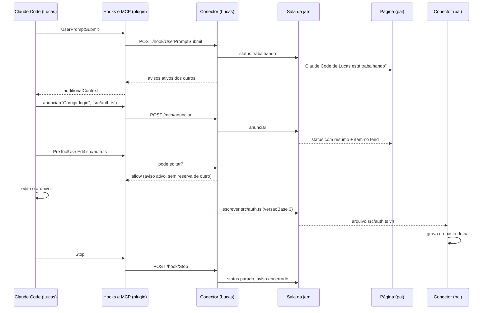

# Components

## App web (`apps/web`)

**Responsibility:** páginas, login, amigos, jams, GitHub, emissão de token da
sala, fechamento com commit.

**Key Interfaces:**
- Páginas: `/`, `/inicio`, `/amigos`, `/jams/nova`, `/jams/[id]`, `/dispositivo`
- REST `/api/*` (acima) e Server Actions

**Dependencies:** Neon, GitHub API, sala (HTTP com segredo de serviço)

**Technology Stack:** Next.js 16, React 19, Tailwind 4, Radix, Better Auth,
Drizzle, Octokit

## Sala da jam (`apps/sala`)

**Responsibility:** uma instância por jam. Autentica conexões pelo JWT,
mantém presença e status, guarda arquivos em andamento e histórico, faz merge
de três vias, registra o feed, trava a jam durante o fechamento, conduz a
divergência ao reabrir.

**Key Interfaces:**
- WebSocket `/parties/jam/{jamId}` (mensagens acima)
- HTTP interno `/parties/jam/{jamId}/interno/*` com segredo de serviço:
  `sobreposicao` (lista e conteúdo dos arquivos mudados), `travar`,
  `concluir-fechamento`, `reabrir`

**Dependencies:** nenhuma em tempo de execução (só valida o JWT com a chave
compartilhada)

**Technology Stack:** Cloudflare Workers, Durable Objects com SQLite,
PartyServer, node-diff3, zod

## Conector (`packages/conector`, publicado no npm)

**Responsibility:** ligar o PC à jam. Comandos `entrar <jam>`, `diagnostico`,
`sair`. Ao entrar:

1. faz login por dispositivo, se ainda não há sessão;
2. clona o repositório ou confere a pasta;
3. instala ou atualiza o plugin do Claude Code para a pasta;
4. abre o servidor local para os hooks;
5. conecta na sala, sincroniza e passa a vigiar a pasta.

**Key Interfaces:**
- CLI `npx coodevelopment entrar <jam>` (nome livre no npm em 23/10/2026;
  publicar uma versão inicial na Story 1.1 para reservá-lo)
- HTTP local em `127.0.0.1:<porta aleatória>`, com segredo por sessão:
  `POST /hook/{evento}` e `POST /mcp/anunciar`
- Arquivo de descoberta: `%LOCALAPPDATA%\coodevelopment\pastas\<sha1 do
  caminho>.json` com `{ porta, segredo, jamId, pid }`

**Dependencies:** app web (login, token da sala), sala (WebSocket), git
instalado, Claude Code instalado (só para o plugin)

**Technology Stack:** Node 22+, partysocket, @parcel/watcher, zod, tsup

## Plugin do Claude Code (`packages/plugin`, embutido no conector)

**Responsibility:** ligar o Claude Code ao conector. Hooks e servidor MCP são
scripts Node pequenos que leem o arquivo de descoberta da pasta (pelo `cwd`
da entrada do hook) e falam com o conector. Sem conector rodando para aquela
pasta, todo hook sai em silêncio com código 0, e o Claude Code segue normal
fora de jam.

**Key Interfaces (hooks):**

| Hook | Matcher | O que faz |
|---|---|---|
| `SessionStart` / `SessionEnd` | n/a | Presença do Claude na sala |
| `UserPromptSubmit` | n/a | Status "trabalhando"; devolve `additionalContext` com os avisos ativos dos outros e a instrução de chamar `anunciar` antes de editar (FR12, FR15) |
| `PreToolUse` | `Edit\|Write\|NotebookEdit` | Sem aviso ativo: `deny` com motivo (FR14). Arquivo reservado por outro: `ask` com quem reservou e por quê, e a pessoa confirma no terminal (FR16) |
| `PreToolUse` / `PostToolUse` | todos | Injeta avisos novos dos outros desde a última injeção (FR15 em respostas longas) |
| `PostToolUse` | `Bash\|PowerShell` | Marca o fim de comando para o vigia agrupar as mudanças que ele causou |
| `Stop` / `StopFailure` | n/a | Status "parado"; encerra o aviso ativo e libera as reservas |

**MCP:** servidor stdio `coodevelopment` com a ferramenta `anunciar(resumo,
arquivos)`. Nome visto pelo Claude: `mcp__plugin_coodevelopment_coodevelopment__anunciar`.

**Technology Stack:** Node, `@modelcontextprotocol/server` v2, zod. Estrutura
de plugin: `.claude-plugin/plugin.json`, `hooks/hooks.json` (com o invólucro
`{"hooks": {...}}`), `.mcp.json`, scripts com `${CLAUDE_PLUGIN_ROOT}`.

**Instalação pelo conector:** o conector copia o plugin para
`%LOCALAPPDATA%\coodevelopment\marketplace\` (com um `marketplace.json`
local) e roda:

```bash
claude plugin marketplace add "%LOCALAPPDATA%\coodevelopment\marketplace" --scope local
claude plugin install coodevelopment@coodevelopment --scope local
```

O escopo `local` grava em `.claude/settings.local.json`, que não vai para o
git, então a jam não suja o repositório dos outros. Na primeira vez o Claude
Code pede aprovação do servidor MCP; o passo de conexão da página avisa
disso. **[verificar na Story 4.1]**: se o Claude Code já estiver aberto na
pasta, ele precisa recarregar plugins (`/plugin` ou reiniciar); o conector
diz isso no terminal.

## Protocolo (`packages/protocolo`)

**Responsibility:** tipos, schemas zod das mensagens e regras puras
compartilhadas: normalização de caminho e de final de linha, hash, lista fixa
de caminhos proibidos, detecção de arquivo de dependências, montagem da
mensagem de commit.

**Dependencies:** só zod. **Technology Stack:** TypeScript puro, sem I/O.

## Component Diagrams


