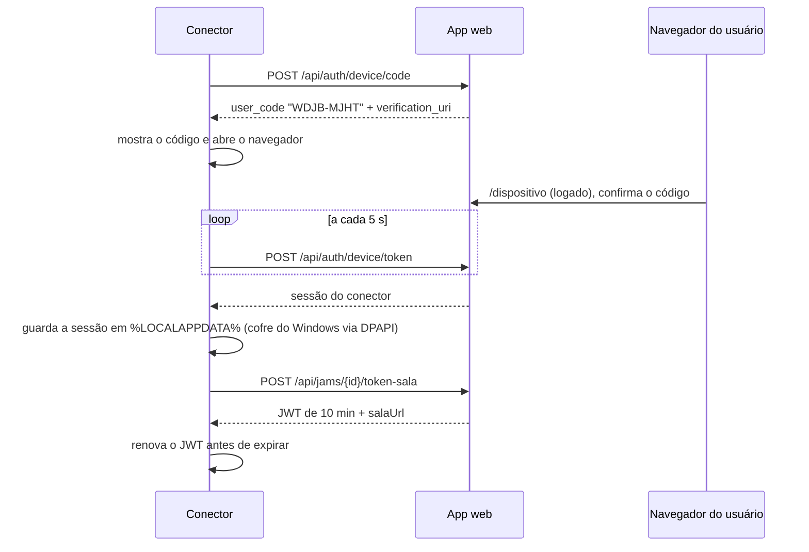
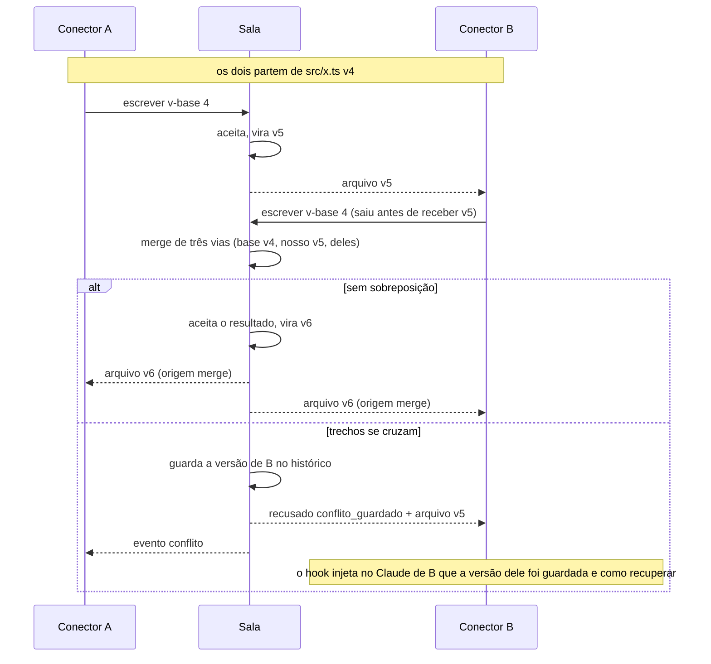
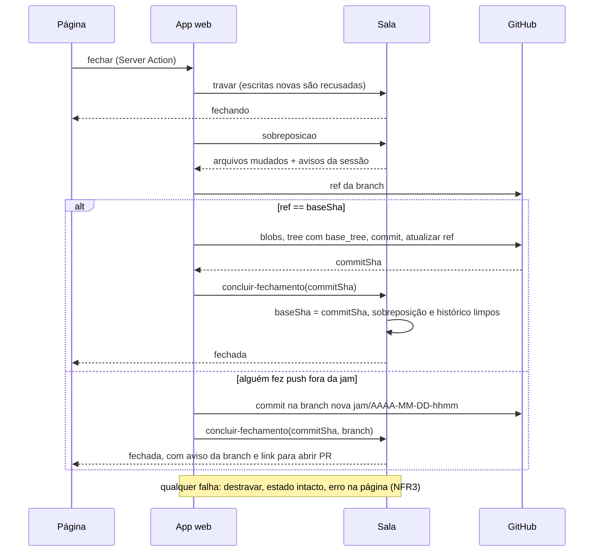

# Core Workflows

## Login do conector por dispositivo

## Escrita simultânea no mesmo arquivo

Regras do conector na sincronização (Story 3.3):

- **Sem eco:** guarda o hash de tudo que gravou vindo da sala; evento do vigia
  com o mesmo hash é ignorado.
- **Mudança local pendente:** se chega da sala um arquivo que tem mudança
  local ainda não enviada, o conector não grava; envia a dele com a versão
  base antiga, e a sala faz o merge.
- **Agrupamento:** espera 150 ms sem eventos no mesmo arquivo antes de
  enviar; salvamento em rajada vira uma escrita.
- **Final de linha:** o hash e o merge usam o conteúdo com LF. Ao gravar, o
  conector usa o final de linha que o arquivo já tinha; arquivo novo segue o
  `core.autocrlf` do git local (NFR7).
- **O que nunca vai:** o que o `git check-ignore` ignora, `.git/`, `.env*`
  (exceto `.env.example`), caminho fora da pasta, link simbólico para fora,
  arquivo acima de 5 MB (vira evento no feed). A lista fixa vale mesmo que o
  `.gitignore` do projeto esqueça.
- **Binário:** detectado por byte nulo nos primeiros 8 KB; sincronizado
  inteiro, sem merge (a última escrita vence e a anterior fica no histórico).

## Fechar a jam (Story 5.1)

A mensagem do commit é montada em `packages/protocolo` (D18): primeira linha
com o resumo do aviso mais citado, corpo com a lista de avisos da sessão por
autor, e um `Co-authored-by: Nome <id+login@users.noreply.github.com>` por
participante. O commit é feito com o token do criador. A mensagem pode ser
editada na confirmação (front-end spec, confirmado).

## Reabrir com a pasta diferente (D17, Story 5.2)

Ao conectar numa jam reaberta, o conector compara a pasta com o estado da jam
(`git diff --name-only <baseSha>` mais os arquivos não rastreados e não
ignorados, contra o manifesto da sala). Se houver diferença, manda
`divergencia` com a lista; a sala pede a escolha à página daquela pessoa.

- **Atualizar:** o conector grava a versão da jam. Antes, copia cada arquivo
  que vai sobrescrever para
  `%LOCALAPPDATA%\coodevelopment\copias\<jam>\<data>\`, para nada local se
  perder sem volta. Arquivos ignorados nunca são tocados.
- **Seguir com a antiga:** o conector entra em modo só local (`soLocal`):
  recebe status e feed, mas não envia nem grava arquivos até a pessoa
  escolher atualizar.
