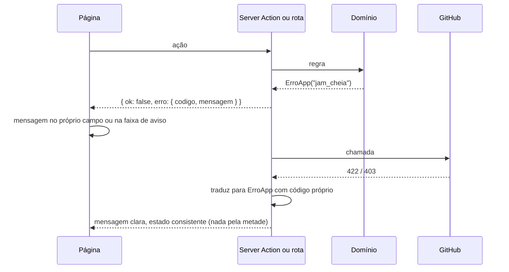

# Error Handling Strategy

## Error Flow



## Error Response Format

```typescript
interface ApiError {
  error: {
    code: string; // ex.: "jam_cheia", "github_limite_colaboradores"
    message: string; // em português, pronta para mostrar
    details?: Record<string, unknown>;
    timestamp: string;
    requestId: string;
  };
}
```

## Frontend Error Handling

```typescript
// Server Actions devolvem resultado, não lançam para a página.
export type Resultado<T> = { ok: true; dados: T } | { ok: false; erro: { codigo: string; mensagem: string } };

export async function executar<T>(f: () => Promise<T>): Promise<Resultado<T>> {
  try {
    return { ok: true, dados: await f() };
  } catch (e) {
    if (e instanceof ErroApp) return { ok: false, erro: { codigo: e.codigo, mensagem: e.message } };
    console.error(JSON.stringify({ nivel: "erro", erro: String(e) }));
    return { ok: false, erro: { codigo: "inesperado", mensagem: "Algo deu errado. Tente de novo." } };
  }
}
```

## Backend Error Handling

```typescript
// apps/web/src/servidor/erros.ts
export class ErroApp extends Error {
  constructor(public codigo: string, public status = 400, mensagem = MENSAGENS[codigo] ?? codigo) {
    super(mensagem);
  }
}

// Rotas: um invólucro só converte ErroApp em ApiError e loga o resto.
export function rota(handler: (req: Request, ctx: any) => Promise<Response>) {
  return async (req: Request, ctx: any) => {
    const requestId = crypto.randomUUID();
    try {
      return await handler(req, ctx);
    } catch (e) {
      const erro = e instanceof ErroApp ? e : new ErroApp("inesperado", 500);
      if (!(e instanceof ErroApp)) console.error(JSON.stringify({ requestId, erro: String(e) }));
      return Response.json(
        { error: { code: erro.codigo, message: erro.message, timestamp: new Date().toISOString(), requestId } },
        { status: erro.status },
      );
    }
  };
}
```

No conector, todo erro vai para o log rotativo e para o modo de diagnóstico;
no terminal aparece uma linha em português dizendo o que fazer.

## Falhas parciais

| Falha | Comportamento |
|---|---|
| Sala fora do ar ou internet caiu | O conector continua vigiando e guarda as mudanças numa fila em disco; o `partysocket` reconecta com espera crescente (1 s até 30 s). Ao voltar, envia a fila com as versões base originais, e a sala faz merge como em qualquer escrita atrasada. Hooks seguem respondendo (sem contexto dos outros) e o Claude nunca é bloqueado por falta de rede |
| Conector parou | A página mostra a pessoa como "não conectada" em até 30 s (fim da conexão); os avisos ativos dela são encerrados e as reservas liberadas |
| GitHub fora do ar no fechamento | Fechamento falha, a jam destrava com estado intacto e a página oferece tentar de novo (NFR3) |
| Token do criador revogado | Fechamento falha com mensagem pedindo ao criador entrar de novo; enquanto isso a jam segue aberta e nada se perde |
| Neon fora do ar | Login e páginas falham com mensagem; jams já abertas continuam sincronizando, porque o tempo real não passa pelo Neon (o token da sala dura 10 min) |
