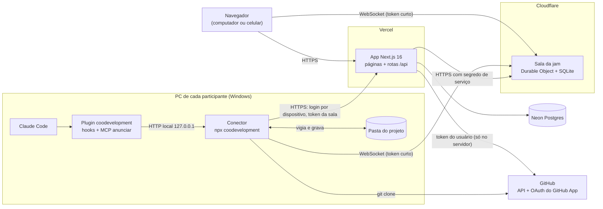

# High Level Architecture

## Technical Summary

O Coodevelopment é um sistema distribuído em quatro partes:

- **App web:** Next.js 16 na Vercel, com Postgres no Neon. Cuida de login,
  amigos, jams, GitHub e commit.
- **Sala da jam:** um Durable Object da Cloudflare por jam, escrito com
  PartyServer. É o centro de tempo real: presença, status dos Claudes, feed e
  o estado atual dos arquivos, guardado no SQLite da própria sala.
- **Conector:** um processo Node que cada participante roda com `npx` no
  próprio PC. Vigia a pasta do projeto, troca arquivos com a sala e atende os
  hooks do Claude Code localmente.
- **Plugin do Claude Code:** instalado pelo conector, com hooks em Node e um
  servidor MCP com a ferramenta `anunciar`.

O app web emite tokens curtos para o navegador e para o conector entrarem na
sala. O token do GitHub nunca sai do servidor da Vercel (NFR8). Ao fechar a
jam, o app lê da sala os arquivos mudados e faz o commit pela API do GitHub,
em cima do commit de partida.

Os objetivos do PRD se cumprem assim:

- **Tempo real (NFR1, NFR2):** conexão aberta direto entre conector e sala,
  sem passar pela Vercel.
- **Nada se perde (NFR3, FR21):** o estado mora na sala, não nos PCs.
- **Qualquer stack (NFR13):** a sincronização trabalha com arquivos e com o
  `.gitignore` do projeto, nunca com linguagem, framework ou banco.

## Platform and Infrastructure Choice

Opções avaliadas (pesquisa de 23/10/2026):

| Opção | Prós | Contras |
|---|---|---|
| **Vercel + Neon + Cloudflare Durable Objects** | Mensagem de até 32 MiB (arquivo de 1 MB vai inteiro); lógica e SQLite por sala; reconexão pronta no cliente `partysocket`; plano gratuito cobre 2 ou 3 pessoas | Segundo deploy (`wrangler`) ao lado da Vercel |
| Vercel + Neon + Liveblocks | Presença e Yjs prontos | Plano gratuito de 3.000 min/mês (três pessoas gastam em cerca de 2 dias); mensagem de 1 MB; sem lógica no servidor |
| Vercel com WebSocket nativo + Upstash Redis | Tudo na Vercel | No Hobby a conexão cai a cada 300 s; presença e fan-out entre instâncias por nossa conta |
| Ably, Pusher, Supabase Realtime | Gerenciados | Mensagem de 10 KB a 256 KB obriga a fatiar arquivo; sem lugar para o estado da jam |

**Escolha: Vercel + Neon + Cloudflare Durable Objects (PartyServer).** É a
única que guarda o estado da jam junto da conexão (FR21) sem custo (NFR11) e
sem fatiar arquivos.

**Platform:** Vercel (app web), Cloudflare Workers com Durable Objects (sala),
Neon (Postgres), GitHub (repositórios e login)
**Key Services:** Vercel Functions, Neon Postgres, Cloudflare Durable Objects
com SQLite, GitHub App, npm (distribuição do conector)
**Deployment Host and Regions:** Vercel `gru1` (São Paulo) para as funções;
Neon `sa-east-1`; Durable Objects com dica de localização `sam` (América do
Sul) **[verificar na Story 2.4]**

## Repository Structure

**Structure:** monorepo
**Monorepo Tool:** pnpm workspaces (sem Turborepo; quatro pacotes não pedem
cache de build)
**Package Organization:** dois apps publicados (web e sala), um pacote
publicado no npm (conector, que carrega o plugin) e um pacote interno de
protocolo, importado pelos outros três.

## High Level Architecture Diagram

## Architectural Patterns

- **Sala autoritativa por jam:** um Durable Object por jam é a única fonte da
  verdade dos arquivos em andamento, da presença e do feed. _Rationale:_ um
  único processo ordena as escritas de cada jam, o que torna a detecção de
  conflito simples e confiável.
- **Base mais sobreposição:** a sala guarda só o commit de partida (`baseSha`)
  e os arquivos que mudaram desde ele, nunca o repositório inteiro.
  _Rationale:_ fica leve com repositório de qualquer tamanho e transforma o
  fechamento num commit direto (base + sobreposição).
- **Controle de concorrência otimista por arquivo:** cada escrita informa a
  versão em que se baseou; se a versão da sala andou, a sala tenta juntar as
  duas (merge de três vias). _Rationale:_ os avisos e as reservas tornam
  conflito raro, então não vale o custo de um editor colaborativo (CRDT).
- **Conector como ponte local:** hooks e MCP falam só com o conector em
  `127.0.0.1`; só o conector fala com a internet. _Rationale:_ hooks rápidos e
  independentes de rede (NFR5) e um só lugar com credenciais no PC.
- **Protocolo tipado compartilhado:** mensagens definidas uma vez em
  `packages/protocolo` com schemas zod e validadas nas duas pontas.
  _Rationale:_ quatro partes evoluindo juntas; erro de formato vira erro de
  compilação ou de validação, nunca comportamento silencioso.
- **Server Components e Server Actions no app web:** páginas renderizadas no
  servidor, mutações por Server Actions, e o tempo real só na página da jam.
  _Rationale:_ menos JavaScript no cliente e o token do GitHub sempre no
  servidor.
- **Tokens curtos para a sala:** o app emite um JWT de 10 minutos por jam e
  por pessoa; a sala só valida. _Rationale:_ a sala não acessa o banco nem
  guarda segredo de usuário.
