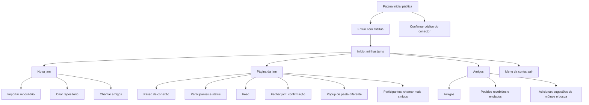
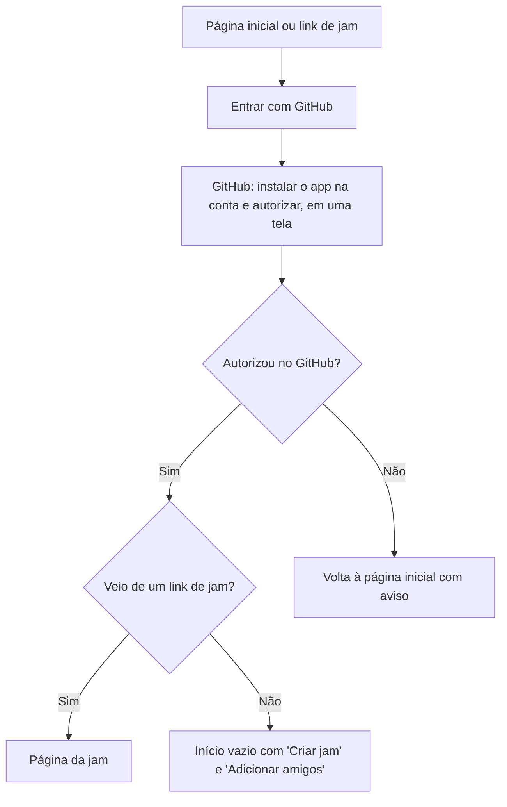
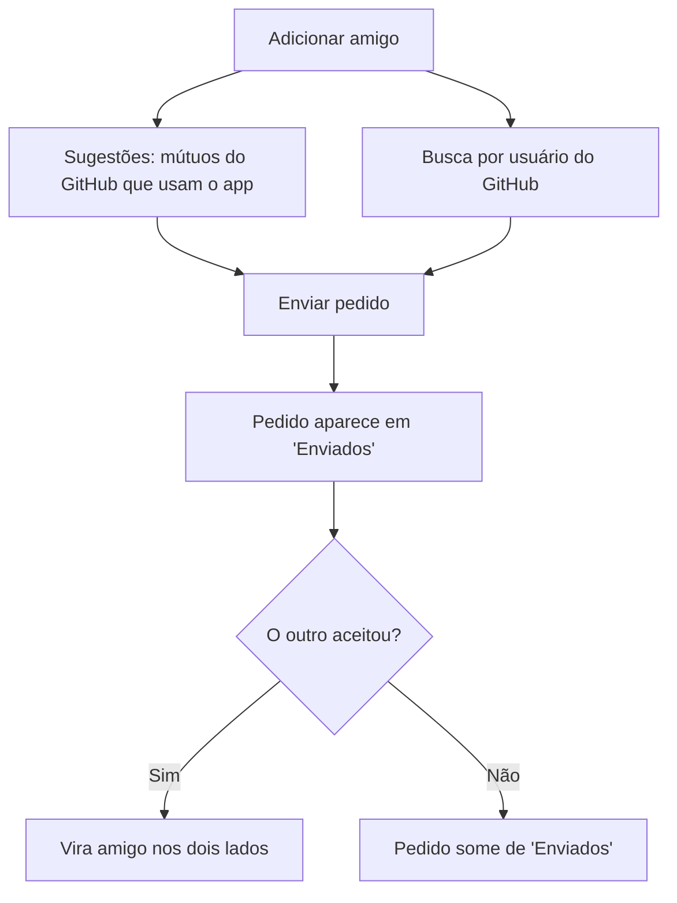
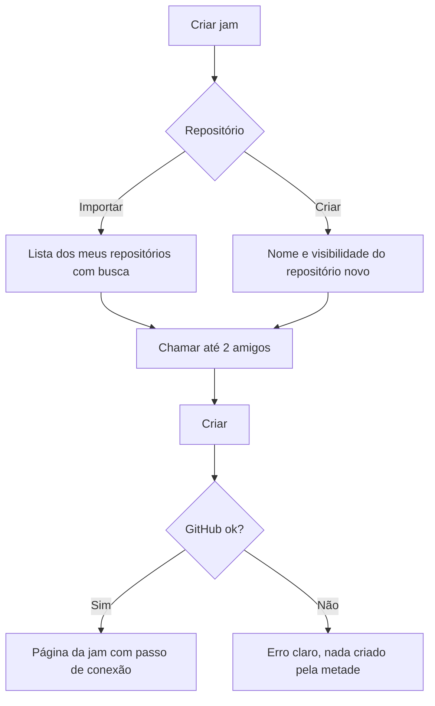
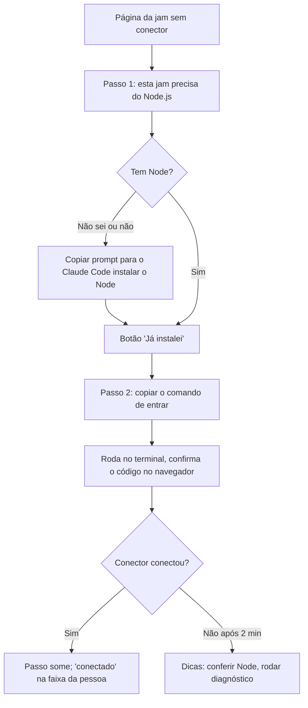
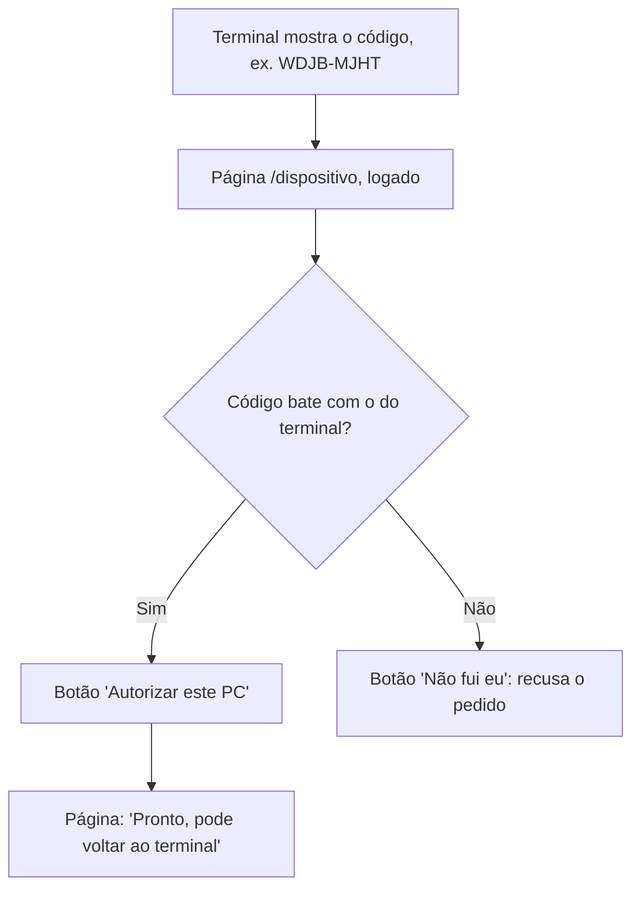
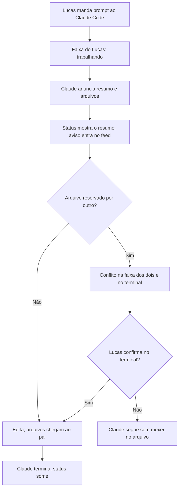
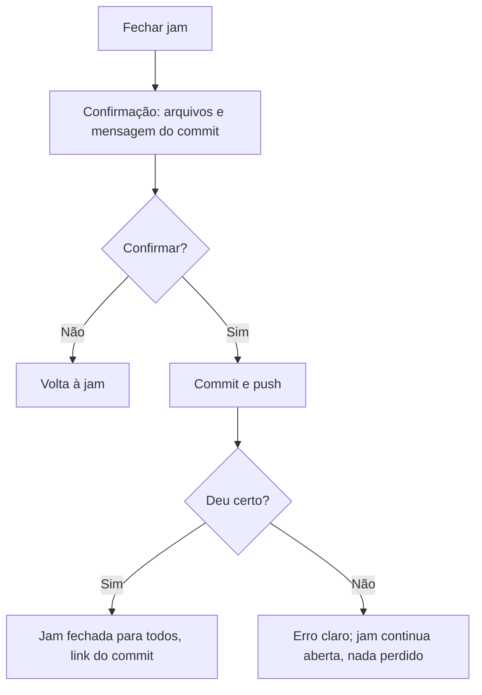
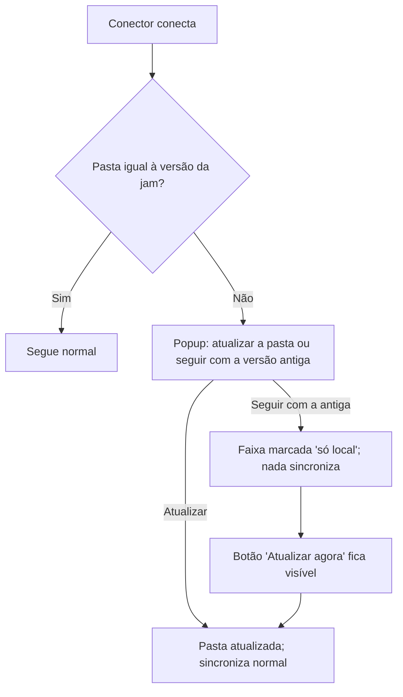

# Coodevelopment UI/UX Specification

Template `front-end-spec-tmpl.yaml` v2.0, gerado em modo YOLO a pedido do
Lucas em 2026-10-22, para revisão no dia seguinte. Escolhas sem pedido
explícito foram marcadas como suposição; o Lucas confirmou todas em
2026-10-23 (versão 0.2), agora marcadas **[confirmado]**. Base: `docs/prd.md` 0.1,
`docs/brief.md` 1.1. Guia visual: os 20 sinais da skill `cara-de-ia` (o
produto não pode ter cara de template de IA).

## Introduction

This document defines the user experience goals, information architecture,
user flows, and visual design specifications for Coodevelopment's user
interface. It serves as the foundation for visual design and frontend
development, ensuring a cohesive and user-centered experience.

### Overall UX Goals & Principles

#### Target User Personas

- **Desenvolvedor na jam (o Lucas, o pai):** já usa o Claude Code todo dia, no
  Windows, com terminal e editor abertos. Usa o app numa aba ao lado ou no
  celular apoiado na mesa. Quer saber de relance o que o outro Claude está
  fazendo e não quer configurar nada além do necessário.
- **Amigo convidado (segmento secundário):** desenvolvedor que entra numa jam
  pela primeira vez; precisa sair do "recebi um convite" para "estou
  conectado" sem ajuda de ninguém.

#### Usability Goals

- **Leitura de relance:** em menos de 2 segundos olhando a página da jam, a
  pessoa sabe quem está trabalhando e em quê.
- **Primeira conexão sozinho:** quem nunca usou conecta à jam em até 5 minutos
  seguindo só a página, inclusive instalando o Node.
- **Nada some sem querer:** toda ação que mexe no repositório (fechar jam,
  atualizar a pasta) mostra o que vai acontecer e pede confirmação.
- **Silêncio quando nada acontece:** sem Claude trabalhando, a página fica
  quieta; nenhum elemento pisca ou se mexe sem motivo.

#### Design Principles

1. **O status é a interface:** a frase "Claude Code de Lucas está trabalhando
   em: ..." é o elemento mais importante de toda a página e tem o maior
   destaque.
2. **Cada pessoa tem uma cor:** a cor do participante marca o status, os
   avisos e os arquivos dele em todo lugar; cor nunca aparece sozinha, sempre
   com nome ou foto.
3. **Ferramenta, não vitrine:** visual sóbrio de ferramenta de desenvolvedor;
   sem degradê, vidro fosco, brilho de fundo ou animação decorativa.
4. **Dizer o que faz:** textos curtos e concretos, em português, sem buzzword
   e sem travessão.
5. **Atualizar sem empurrar:** o que chega em tempo real entra no lugar dele
   sem deslocar o que a pessoa está lendo.

### Change Log

| Date | Version | Description | Author |
|---|---|---|---|
| 2026-10-22 | 0.1 | Primeira versão, modo YOLO, a partir do PRD 0.1 | Uma (@ux-design-expert), via Claude |
| 2026-10-23 | 0.2 | Lucas confirmou todas as suposições | Uma (@ux-design-expert), via Claude |
| 2026-10-23 | 0.3 | Ajustes da validação do @po: instalação do GitHub App no login, tela de confirmar o código do conector, Git no prompt, aviso de aprovar o MCP | Pax (@po), via Claude |
| 2026-10-27 | 0.4 | Página inicial igual ao `responsive-hero-banner` do 21st.dev, com os aplicativos do Grupo RAM em loop (V1), e primária no verde do Grupo RAM (V2) | Uma (@ux-design-expert), via Claude |

## Information Architecture (IA)

### Site Map / Screen Inventory



### Navigation Structure

**Primary Navigation:** barra superior fixa com o nome do app (leva ao
Início), "Jams", "Amigos" (com contador de pedidos recebidos) e a foto do
usuário (menu com "Sair"). No celular, "Jams" e "Amigos" viram uma barra
inferior com dois itens.

**Secondary Navigation:** dentro da página da jam não há abas no
computador: participantes à esquerda, feed à direita. No celular, as duas
áreas ficam empilhadas e um seletor "Pessoas | Feed" fixo no topo da jam leva
a cada uma.

**Breadcrumb Strategy:** sem breadcrumb; a hierarquia tem dois níveis. Na
página da jam, o título mostra `dono/repositório` e um link "Jams" volta ao
Início.

## User Flows

### Entrar pela primeira vez

**User Goal:** ter uma conta no app usando o GitHub.

**Entry Points:** página inicial pública; link de uma jam recebido de um amigo.

**Success Criteria:** usuário logado, com nome e foto do GitHub, no Início (ou
na jam que tentou abrir).

#### Flow Diagram



#### Edge Cases & Error Handling:

- Recusou a permissão no GitHub: mensagem dizendo o que o app precisa e por
  quê, com botão para tentar de novo.
- Na tela do GitHub, a opção de repositórios deve ser "All repositories";
  antes de mandar ao GitHub, a página diz em uma linha por quê (a jam pode
  criar repositório novo, e ele precisa já estar coberto). Se a pessoa
  escolher "Only select repositories", a tela de nova jam avisa quando o
  repositório não está coberto e leva de volta à configuração do app no
  GitHub.
- Link de jam da qual a pessoa não participa: página "Você não está nesta
  jam", com o nome de quem a criou.

**Notes:** a página inicial diz em uma frase o que o produto faz ("Programe
junto com seus amigos, cada um com o seu Claude Code, vendo ao vivo o que cada
Claude está fazendo").

### Adicionar um amigo

**User Goal:** ter alguém na lista de amigos para chamar para jams.

**Entry Points:** "Amigos" > "Adicionar"; Início vazio.

**Success Criteria:** pedido enviado; amizade criada quando o outro aceita.

#### Flow Diagram



#### Edge Cases & Error Handling:

- Nenhum mútuo usa o app: a área de sugestões explica isso e destaca a busca.
- Busca por alguém sem conta: "Ninguém com esse usuário usa o Coodevelopment
  ainda."
- Pedido para quem já mandou pedido para mim: vira aceite direto
  **[confirmado]**.

**Notes:** sugestão não cria amizade (D12).

### Criar uma jam

**User Goal:** abrir uma sala ligada a um repositório, com os amigos dentro.

**Entry Points:** Início > "Criar jam".

**Success Criteria:** jam criada, amigos colaboradores do repositório, criador
na página da jam.

#### Flow Diagram



#### Edge Cases & Error Handling:

- Sem amigos: dá para criar a jam sozinho e chamar depois pela página da jam.
- Nome de repositório já existente: erro no próprio campo.
- Falha ao adicionar um colaborador: a jam é criada, o amigo fica marcado
  "não adicionado" com botão de tentar de novo **[confirmado]**.

**Notes:** o limite de 2 amigos aparece como contador ("1 de 2").

### Conectar o PC à jam

**User Goal:** ligar o Claude Code e a pasta do projeto à jam.

**Entry Points:** primeira vez na página da jam; página da jam com o conector
desligado.

**Success Criteria:** participante aparece "conectado" e o passo some.

#### Flow Diagram



#### Edge Cases & Error Handling:

- O navegador não detecta o Node, por isso o botão "Já instalei" (D13).
- Pasta já existe e não é o repositório da jam: o conector explica no terminal
  e a página mostra "a pasta escolhida não é deste repositório".
- Conector cai: a faixa da pessoa passa a "desconectado" depois de alguns
  segundos e o passo de conexão volta, só para ela.

- Na primeira vez, o Claude Code pede para aprovar o servidor MCP
  "coodevelopment": o passo 2 avisa disso em uma linha ("quando o Claude Code
  perguntar, aprove o coodevelopment"), e o terminal do conector repete.

**Notes:** texto do prompt para o Claude Code (com botão copiar): *"Instale o
Node.js LTS e o Git neste computador Windows, se ainda não estiverem
instalados (por exemplo com `winget install OpenJS.NodeJS.LTS` e `winget
install Git.Git`), depois rode `node -v`, `npx -v` e `git --version` e me diga
as versões."*

### Confirmar o código do conector

**User Goal:** autorizar o conector do próprio PC sem colar token.

**Entry Points:** o conector abre o navegador em `/dispositivo` (ou a pessoa
digita o endereço mostrado no terminal).

**Success Criteria:** o terminal diz "conectado como {nome}" e a página
confirma.

#### Flow Diagram



#### Edge Cases & Error Handling:

- Código vencido (10 minutos): a página diz isso e manda rodar o comando de
  novo.
- Não logado: login com GitHub e volta para a mesma tela com o código
  preenchido.

**Notes:** a página mostra o código em fonte mono grande e pede para conferir
com o terminal antes de autorizar; nada é autorizado só por abrir o link.

### Trabalhar junto (o fluxo principal)

**User Goal:** cada um pede coisas ao próprio Claude sabendo o que os outros
estão fazendo.

**Entry Points:** página da jam com o conector ligado.

**Success Criteria:** status e avisos visíveis em até 1 s; nenhum conflito sem
aviso.

#### Flow Diagram



#### Edge Cases & Error Handling:

- Claude para por erro (limite de uso, autenticação): a faixa mostra "parou:
  limite de uso atingido" por alguns segundos e volta a ocioso.
- Mudança sem aviso (comando de terminal): item no feed marcado "sem aviso".
- Arquivo de dependências mudou: item destacado "dependências mudaram,
  reinstale no seu PC".

**Notes:** a confirmação do conflito acontece no terminal de quem pediu
**[confirmado, FR16]**.

### Fechar a jam

**User Goal:** salvar no GitHub o trabalho de todos.

**Entry Points:** botão "Fechar jam" no cabeçalho; atalho no lembrete de
trabalho não salvo.

**Success Criteria:** commit e push feitos; jam marcada fechada para todos.

#### Flow Diagram



#### Edge Cases & Error Handling:

- Alguém com Claude trabalhando: a confirmação avisa "o Claude do pai ainda
  está trabalhando" antes de deixar fechar.
- Nada mudou desde o último commit: fecha sem commit e diz isso.

**Notes:** a mensagem do commit é montada dos avisos (D18), editável na
confirmação **[confirmado]**.

### Reabrir com a pasta diferente

**User Goal:** voltar a uma jam sem estragar o trabalho de ninguém.

**Entry Points:** conectar a uma jam reaberta com a pasta local divergente.

**Success Criteria:** a pessoa escolhe conscientemente atualizar ou ficar só
local.

#### Flow Diagram



#### Edge Cases & Error Handling:

- O popup lista os arquivos diferentes, para a pessoa saber o que muda.
- Arquivos ignorados pelo `.gitignore` nunca são tocados.

**Notes:** popup na página da jam, não no terminal **[confirmado]** (D17 diz
"popup").

## Wireframes & Mockups

**Primary Design Files:** sem ferramenta de design por enquanto
**[confirmado]**; os leiautes abaixo são a referência, e a primeira versão da
página da jam serve de protótipo.

### Key Screen Layouts

#### Página da jam (computador)

**Purpose:** mostrar de relance quem está na jam e o que cada Claude está
fazendo, com o histórico ao lado.

**Key Elements:**
- Cabeçalho: `dono/repositório`, quantos estão conectados, lembrete de
  trabalho não salvo (quando houver) e botão "Fechar jam".
- Coluna esquerda (cerca de 40%): uma faixa por participante, com foto, nome,
  marca de cor, estado do conector e, em destaque, o status do Claude; abaixo
  do status, os arquivos anunciados como etiquetas.
- Coluna direita (cerca de 60%): feed em ordem cronológica, mais recente em
  cima, com filtro "Tudo | Avisos | Arquivos".
- Passo de conexão no lugar da faixa do próprio usuário enquanto ele não
  conectou.

```
┌──────────────────────────────────────────────────────────────────┐
│ Coodevelopment   Jams  Amigos                            (foto) │
├──────────────────────────────────────────────────────────────────┤
│ lucas/loja-da-familia     2 de 2 conectados        [Fechar jam] │
├─────────────────────────┬────────────────────────────────────────┤
│ ▌(foto) Lucas  conectado │ Tudo | Avisos | Arquivos               │
│ ▌Claude Code de Lucas    │ ─────────────────────────────────────  │
│ ▌está trabalhando em:    │ ▌Lucas anunciou · agora                │
│ ▌"tela de login com      │ ▌tela de login com validação           │
│ ▌ validação"   há 1 min  │ ▌app/login/page.tsx  lib/auth.ts       │
│ ▌[app/login/page.tsx]    │                                        │
│                          │ ▌pai alterou lib/estoque.ts · 2 min    │
│ ▌(foto) Pai   conectado  │ ▌+12 −3                                │
│ ▌Claude Code parado      │                                        │
└─────────────────────────┴────────────────────────────────────────┘
```

**Interaction Notes:** status e feed atualizam sozinhos; item novo no feed
entra no topo sem empurrar a leitura se a pessoa rolou para baixo (aparece
"3 novos" para voltar ao topo). Etiqueta de arquivo copia o caminho ao clicar.

**Design File Reference:** este documento.

#### Página da jam (celular)

**Purpose:** acompanhar a jam com o celular ao lado do PC.

**Key Elements:**
- Cabeçalho compacto com o repositório e menu (Fechar jam fica no menu).
- Seletor fixo "Pessoas | Feed".
- Faixas de participantes compactas: foto, nome e a frase do status em até 3
  linhas.

**Interaction Notes:** abre em "Pessoas", porque o status é o que importa de
relance.

**Design File Reference:** este documento.

#### Início (minhas jams)

**Purpose:** voltar a uma jam ou criar outra.

**Key Elements:**
- Lista de jams abertas primeiro, depois as fechadas; cada item com
  repositório, fotos dos participantes e, se houver Claude trabalhando agora,
  a frase do status de quem está.
- Botão "Criar jam".
- Estado vazio com "Criar jam" e "Adicionar amigos".

**Interaction Notes:** lista simples, sem cards em grade de três.

**Design File Reference:** este documento.

#### Amigos

**Purpose:** gerenciar amigos e pedidos.

**Key Elements:**
- Pedidos recebidos no topo, com aceitar e recusar.
- "Adicionar": sugestões de mútuos do GitHub que usam o app, e campo de busca.
- Lista de amigos com opção de desfazer amizade (com confirmação).

**Interaction Notes:** enviar pedido muda o botão para "Pedido enviado" na
hora.

**Design File Reference:** este documento.

#### Nova jam

**Purpose:** criar a jam em uma tela só.

**Key Elements:**
- Escolha "Importar repositório | Criar repositório".
- Lista com busca dos repositórios (importar) ou campos de nome e
  visibilidade (criar).
- Seleção de amigos com contador "0 de 2".

**Interaction Notes:** o botão "Criar jam" só habilita com repositório
escolhido; amigos são opcionais.

**Design File Reference:** este documento.

## Component Library / Design System

**Design System Approach:** sistema próprio e pequeno, em Tailwind com tokens
CSS (claro e escuro), sobre primitivos acessíveis sem estilo (Radix) para
diálogo, menu e seletor **[confirmado]**. Nada de biblioteca pronta com
aparência padrão. Ícones: poucos, só onde ajudam a reconhecer (copiar,
fechar, aviso, arquivo, conectado), traço de 1,5 px, sempre com texto ou
`aria-label`.

### Core Components

#### Faixa do participante

**Purpose:** mostrar uma pessoa e o Claude dela.

**Variants:** completa (computador), compacta (celular, Início).

**States:** desconectado; conectado e Claude parado; trabalhando (sem resumo
ainda); trabalhando com resumo; conflito; parou por erro; só local (D17).

**Usage Guidelines:** a marca de cor fica na borda esquerda (4 px); o texto do
status usa o tamanho de destaque; o tempo ("há 1 min") em texto secundário.
Indicador de "trabalhando": três pontos com animação discreta, desligada com
movimento reduzido.

#### Item do feed

**Purpose:** registrar o que aconteceu.

**Variants:** aviso, arquivo alterado, sem aviso, dependências mudaram,
conflito, sistema (entrou, saiu, jam fechada).

**States:** novo (fundo levemente marcado por 2 s), normal, agrupado
("pai alterou 4 arquivos").

**Usage Guidelines:** autor e hora sempre visíveis; variantes "sem aviso",
"dependências" e "conflito" têm ícone e texto, nunca só cor.

#### Passo de conexão

**Purpose:** levar a pessoa de "sem conector" a "conectado".

**Variants:** passo do Node, passo do comando, aguardando conexão, ajuda
(após 2 min).

**States:** atual, concluído, com erro.

**Usage Guidelines:** um passo por vez; cada um com uma frase de explicação e
um bloco de copiar.

#### Bloco de copiar

**Purpose:** prompt ou comando para colar no terminal ou no Claude Code.

**Variants:** comando (uma linha), prompt (várias linhas).

**States:** normal, copiado ("Copiado" por 2 s).

**Usage Guidelines:** fonte mono; botão "Copiar" com texto, não só ícone.

#### Etiqueta de arquivo

**Purpose:** mostrar um caminho de arquivo.

**Variants:** anunciado, alterado, em conflito.

**States:** normal, foco, copiado.

**Usage Guidelines:** mono, encurta o meio do caminho em telas pequenas
(`app/…/page.tsx`), caminho completo no `title`.

#### Diálogo de confirmação

**Purpose:** fechar jam, desfazer amizade, popup de pasta diferente.

**Variants:** simples, com lista (arquivos do commit, arquivos diferentes).

**States:** aberto, processando, erro.

**Usage Guidelines:** a ação principal diz o que faz ("Fechar e commitar"),
nunca "OK".

#### Botão

**Purpose:** ações.

**Variants:** principal, secundário, perigo, só texto.

**States:** normal, hover, foco, pressionado, desabilitado, carregando.

**Usage Guidelines:** uma ação principal por tela; hover em até 150 ms.

#### Avatar

**Purpose:** foto do GitHub.

**Variants:** 24, 32 e 40 px.

**States:** com foto, sem foto (iniciais sobre a cor do participante).

**Usage Guidelines:** sempre acompanhado do nome em listas.

## Branding & Style Guide

### Visual Identity

**Brand Guidelines:** não há marca prévia. Esta seção define a base
**[confirmado]**: ferramenta de desenvolvedor sóbria, fundo cor de papel no
claro, quase preto quente no escuro, e a cor dos participantes como único
elemento colorido forte. Checagem contra os 20 sinais de cara de IA: sem
degradê (1, 2, 20), sem emoji (3), fonte com personalidade (4, 19), sem
borda neon nem vidro (5, 6), escuro com contraste real (7), sem fileira de 3
ícones (8), sem brilho de fundo (9), poucos ícones (10), sem depoimento (11),
sem fade-in na rolagem nem luz no mouse (12, 13), hover rápido (14), escala
fixa (15), texto à esquerda (16), texto concreto (17, 18).

**Exceção, a faixa da página inicial (V1, 2026-10-27):** é o
`responsive-hero-banner` do 21st.dev igual ao prompt, a pedido do Lucas:
foto de fundo do componente (servida pelo próprio app), menu em pílula
translúcida com o botão branco, selo e botão principal translúcidos, título
em Instrument Serif, texto em Inter e entrada com deslize ao carregar, nas
cores do componente (branco e preto translúcidos, sem a primária). No lugar
dos logos de parceiros, os aplicativos do Grupo RAM passam em loop, em
branco. Abaixo da faixa, a seção "Como funciona" com os três passos, no
mesmo fundo. Esses sinais valem lá de propósito e só lá; as telas internas
continuam sóbrias como acima.

### Color Palette

Contrastes calculados (WCAG) sobre a superfície e sobre o fundo; todos os
textos passam de 4,5:1 e os controles de 3:1.

| Color Type | Hex Code | Usage |
|---|---|---|
| Primary | `#0F7433` nos dois temas, o verde do Grupo RAM (V2) | Ação principal e foco, só como preenchimento: texto branco sobre ela dá 5,9:1; como contorno de foco, 5,4:1 no claro e 3,1:1 no escuro |
| Secondary | Participante 1 `#AD4719` / `#F08A5B`; participante 2 `#24708F` / `#6BB8D6`; participante 3 `#7C600F` / `#D9B44A` | Marca de cada pessoa: faixa, avisos, arquivos dela |
| Accent | `--destaque`: `#0F7433` (claro) / `#4CC27A` (escuro) | Verde em texto (links, números, a segunda linha do título da página inicial): 5,4:1 sobre o fundo claro e 8,2:1 sobre o escuro. O destaque visual das telas internas continua vindo das cores dos participantes |
| Success | `#2D7A4B` / `#6CC891` | Conectado, commit feito |
| Warning | `#9A6410` / `#E3A74A` | Lembrete de trabalho não salvo, "sem aviso", dependências |
| Error | `#B3362A` / `#F07C6E` | Conflito, erros, ações destrutivas |
| Neutral | Claro: fundo `#F7F5F0`, superfície `#FFFFFF`, texto `#1C1B19`, secundário `#68645C`, divisória `#D6D1C6`, borda de controle `#8A8579`. Escuro: fundo `#141413`, superfície `#1E1D1B`, texto `#F2EFE8`, secundário `#A8A397`, divisória `#3A3833`, borda de controle `#7A766C` | Texto, bordas, fundos |

### Typography

#### Font Families

- **Primary:** IBM Plex Sans **[confirmado]** (tem cara de ferramenta técnica
  sem ser a Inter de todo template; boa em português)
- **Secondary:** a mesma, em pesos diferentes (sem par de fontes)
- **Monospace:** IBM Plex Mono (comandos, prompts, caminhos de arquivo)
- **Página inicial (V1):** Inter no texto e Instrument Serif 400 nos
  títulos, como no componente original; só nas páginas públicas

#### Type Scale

| Element | Size | Weight | Line Height |
|---|---|---|---|
| H1 | 28 px | 600 | 1.2 |
| H2 | 22 px | 600 | 1.25 |
| H3 | 18 px | 600 | 1.3 |
| Body | 15 px | 400 | 1.5 |
| Small | 13 px | 400 | 1.4 |

O texto do status do Claude usa 17 px, peso 500, para ser o maior texto
corrido da página da jam.

A faixa da página inicial tem título próprio, fora desta escala: 36 px no
celular, 48 px a partir de 640 px, 60 px a partir de 768 px e 72 px a partir
de 1024 px.

### Iconography

**Icon Library:** subconjunto pequeno do Lucide (cerca de 10 ícones),
traço 1,5 px, ajustados ao tamanho do texto **[confirmado]**.

**Usage Guidelines:** ícone só onde ajuda a reconhecer uma ação ou um tipo de
item do feed; nunca decorativo; sempre com texto ao lado ou `aria-label`.

### Spacing & Layout

**Grid System:** largura máxima de 1200 px no computador; página da jam em
duas colunas (cerca de 40/60) acima de 1024 px; uma coluna abaixo.

**Spacing Scale:** 4, 8, 12, 16, 24, 32, 48 px, sem valores fora da escala.
Raio de borda: 6 px em controles e faixas, 10 px em diálogos.

## Accessibility Requirements

### Compliance Target

**Standard:** WCAG 2.2 AA.

### Key Requirements

**Visual:**
- Color contrast ratios: texto 4,5:1 ou mais, texto grande e controles 3:1 ou
  mais, nos dois temas (valores conferidos na paleta).
- Focus indicators: anel de 2 px na cor primária com 2 px de afastamento,
  sempre visível ao navegar por teclado.
- Text sizing: legível com zoom de 200% sem rolagem horizontal; tamanhos em
  `rem`.

**Interaction:**
- Keyboard navigation: tudo acessível por teclado; ordem do Tab segue a
  leitura; diálogos prendem o foco e fecham com Esc; atalho para pular para o
  feed.
- Screen reader support: o status de cada participante é anunciado por
  `aria-live="polite"` só quando muda de estado (não a cada item do feed);
  o feed é uma lista com rótulo; ícones com `aria-label`.
- Touch targets: 44 x 44 px no mínimo.

**Content:**
- Alternative text: foto do participante com o nome dele; ícones
  decorativos com `alt=""`.
- Heading structure: um H1 por página (repositório na jam), H2 para
  "Pessoas" e "Feed".
- Form labels: todo campo com rótulo visível; erros abaixo do campo, em texto.

### Testing Strategy

`accessibility-wcag-checklist.md` do AIOX em cada épico com tela; axe
automatizado nos testes de ponta a ponta; navegação só por teclado e leitura
com NVDA (Windows, que é o que os usuários usam) na página da jam.

## Responsiveness Strategy

### Breakpoints

| Breakpoint | Min Width | Max Width | Target Devices |
|---|---|---|---|
| Mobile | 360 px | 767 px | Celular ao lado do PC |
| Tablet | 768 px | 1023 px | Tablet, janela estreita |
| Desktop | 1024 px | 1439 px | Notebook, aba ao lado do editor |
| Wide | 1440 px | - | Monitor grande |

### Adaptation Patterns

**Layout Changes:** página da jam em duas colunas a partir de 1024 px; abaixo
disso, uma coluna com seletor "Pessoas | Feed".

**Navigation Changes:** barra superior no computador; barra inferior com
"Jams" e "Amigos" no celular; "Fechar jam" vai para o menu da jam no celular.

**Content Priority:** no celular, status dos participantes primeiro; o feed
mostra só o resumo de cada item, com toque para ver os arquivos.

**Interaction Changes:** etiquetas de arquivo encurtam o meio do caminho;
blocos de copiar quebram linha em vez de rolar de lado.

## Animation & Micro-interactions

### Motion Principles

Movimento só para dizer que algo mudou de estado, nunca para enfeitar. Nada
entra com fade-in ao rolar. Tudo curto (150 ms ou menos em respostas ao
usuário) e desligado ou reduzido a troca simples com
`prefers-reduced-motion`.

Exceção (V1): a faixa da página inicial entra uma vez, ao carregar, com
opacidade e deslize de 20 px (700 ms, ease-out, em cascata de 100 ms). Não
anima ao rolar, e com movimento reduzido não anima. A faixa dos aplicativos
do Grupo RAM anda sem parar (cerca de 45 px/s), para com o mouse em cima ou
pelo botão de pausa (WCAG 2.2.2) e, com movimento reduzido, fica parada em
grade.

### Key Animations

- **Claude trabalhando:** três pontos alternando opacidade ao lado do status
  (Duration: 1200 ms por ciclo, Easing: ease-in-out); com movimento reduzido,
  pontos parados.
- **Status mudou:** texto novo substitui o antigo com troca de opacidade
  (Duration: 120 ms, Easing: ease-out).
- **Item novo no feed:** fundo levemente marcado que some (Duration: 2000 ms,
  Easing: linear); sem deslizar.
- **Hover e pressionar:** mudança de cor (Duration: 120 ms, Easing: ease-out).
- **Diálogo:** aparece com opacidade e escala de 98% para 100% (Duration: 140
  ms, Easing: ease-out).
- **Copiado:** botão troca para "Copiado" (Duration: imediato; volta após 2 s).

## Performance Considerations

### Performance Goals

- **Page Load:** página da jam utilizável em até 2,5 s numa conexão comum
  (LCP).
- **Interaction Response:** resposta visual a clique em até 100 ms; status
  recebido do tempo real na tela em até 100 ms após chegar (o total de 1 s é
  do NFR1).
- **Animation FPS:** 60 fps; só opacidade e transformação são animadas.

### Design Strategies

- O feed carrega os últimos 50 itens e busca mais ao rolar.
- Atualizações em tempo real agrupadas por quadro, para uma rajada de
  arquivos não travar a página.
- Fontes com `font-display: swap` e só os pesos usados (400, 500, 600).
- Sem imagens decorativas; as únicas imagens são as fotos do GitHub, em
  tamanho fixo.

## Next Steps

### Immediate Actions

1. ~~Lucas revisa as suposições~~: todas confirmadas em 23/10 (fonte IBM
   Plex, paleta, popup da D17 na página da jam, mensagem do commit editável,
   pedido cruzado virando aceite).
2. @architect cria a arquitetura (PRD > Next Steps > Architect Prompt),
   considerando este documento para a parte web.
3. A primeira tela construída (página da jam da Story 2.4) serve de protótipo;
   rodar a skill `cara-de-ia` (`audit.py`) nela antes de seguir.
4. Em aberto: nome curto para mostrar no app (o domínio usa
   "coodevelopment"); logotipo, se houver.

### Design Handoff Checklist

- [x] All user flows documented
- [x] Component inventory complete
- [x] Accessibility requirements defined
- [x] Responsive strategy clear
- [ ] Brand guidelines incorporated (base proposta, sem marca aprovada)
- [x] Performance goals established

## Checklist Results

`accessibility-wcag-checklist.md` aplicado à especificação (não há código
ainda; itens de implementação ficam para o QA de cada story):

- **Perceivable:** contraste conferido por cálculo nos dois temas (texto
  4,5:1 ou mais, controles 3:1 ou mais); nenhum indicador só por cor (status
  e feed usam texto e ícone); paridade do modo escuro definida. OK na
  especificação.
- **Operable:** teclado, ordem do Tab, foco visível, diálogos sem armadilha e
  atalho para o feed definidos. OK na especificação.
- **Understandable:** rótulos, erros em texto, estados de carregando e
  regiões `aria-live` definidos. OK na especificação.
- **Robust:** HTML semântico e ARIA correta ficam para a implementação.
  Pendente (verificar com axe e NVDA).

**Resultado:** especificação compatível com WCAG AA; validação real depende
das telas.
