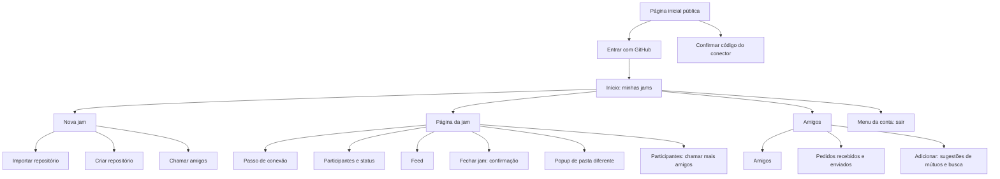

# Information Architecture (IA)

## Site Map / Screen Inventory

## Navigation Structure

**Primary Navigation:** barra superior fixa com o nome do app (leva ao
Início), "Jams", "Amigos" (com contador de pedidos recebidos) e a foto do
usuário (menu com "Sair"). No celular, "Jams" e "Amigos" viram uma barra
inferior com dois itens.

**Secondary Navigation:** dentro da página da jam não há abas no
computador: participantes à esquerda, feed à direita. No celular, as duas
áreas ficam empilhadas e um seletor "Pessoas | Feed" fixo no topo da jam leva
a cada uma.

**Breadcrumb Strategy:** sem breadcrumb; a hierarquia tem dois níveis. Na
página da jam, o título mostra `dono/repositório` e um link "Jams" volta ao
Início.
