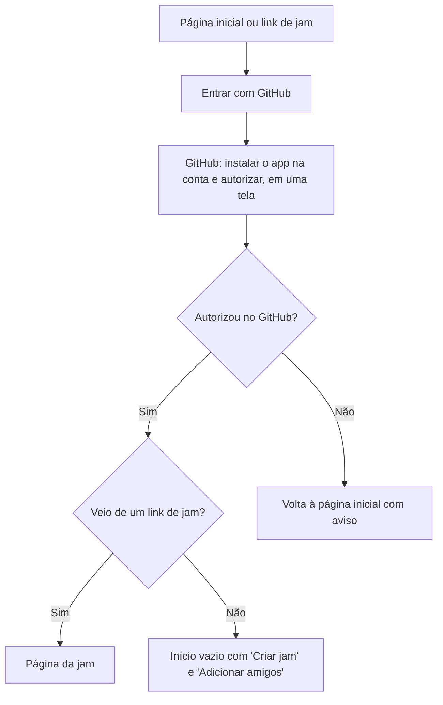
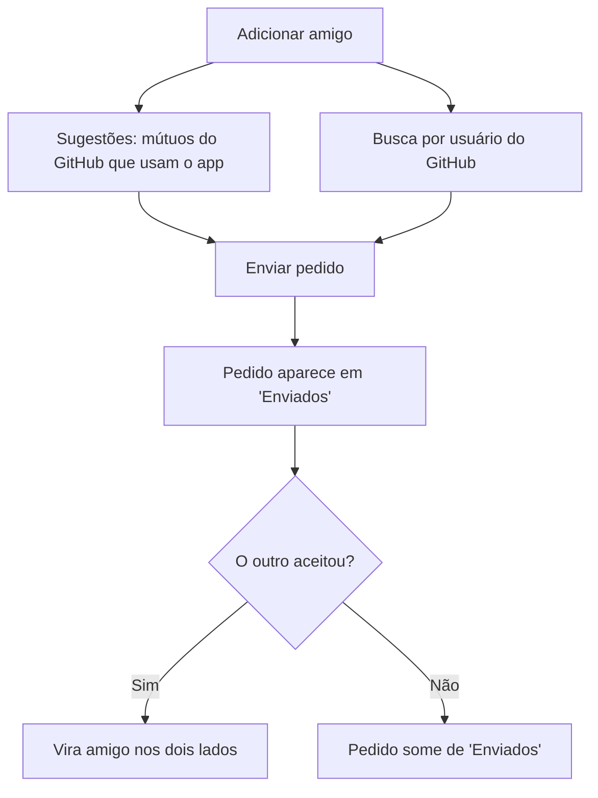
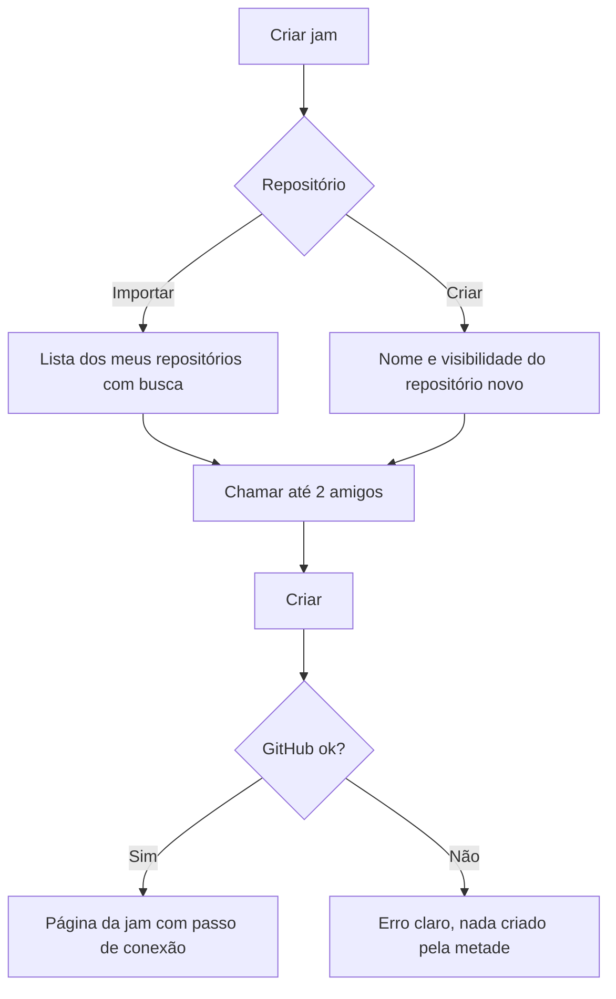
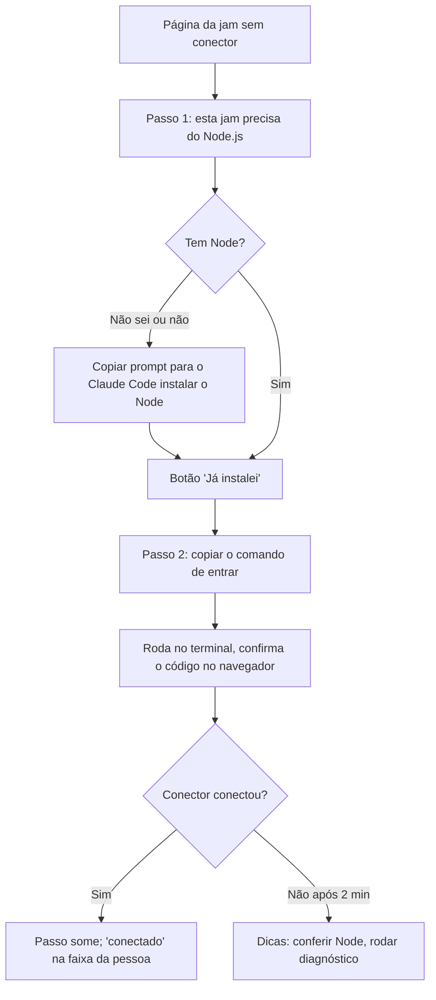
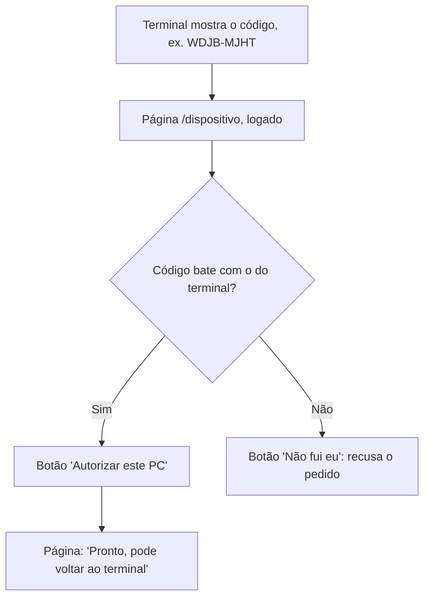
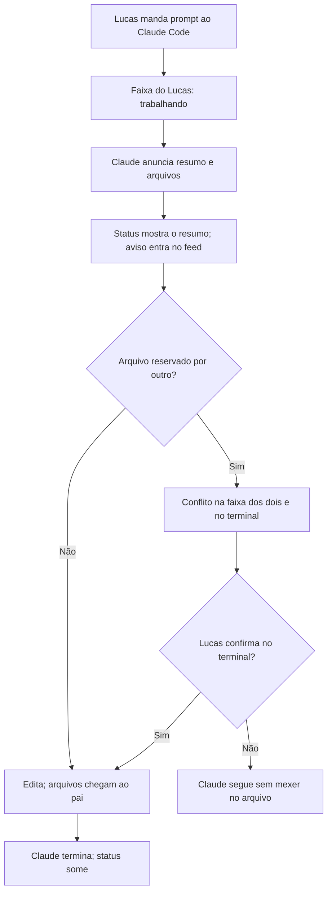
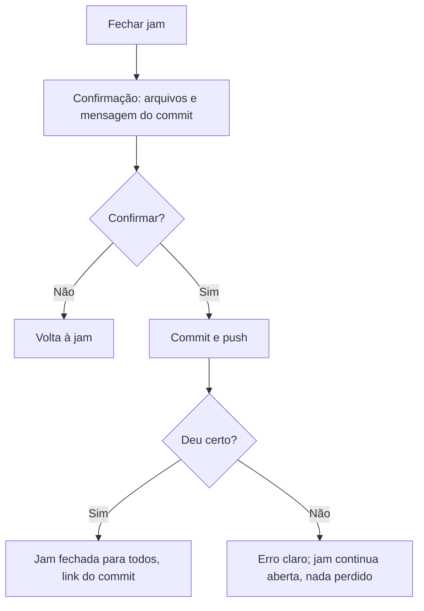
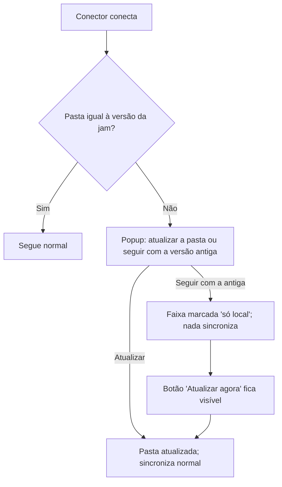

# User Flows

## Entrar pela primeira vez

**User Goal:** ter uma conta no app usando o GitHub.

**Entry Points:** página inicial pública; link de uma jam recebido de um amigo.

**Success Criteria:** usuário logado, com nome e foto do GitHub, no Início (ou
na jam que tentou abrir).

### Flow Diagram

### Edge Cases & Error Handling:

- Recusou a permissão no GitHub: mensagem dizendo o que o app precisa e por
  quê, com botão para tentar de novo.
- Na tela do GitHub, a opção de repositórios deve ser "All repositories";
  antes de mandar ao GitHub, a página diz em uma linha por quê (a jam pode
  criar repositório novo, e ele precisa já estar coberto). Se a pessoa
  escolher "Only select repositories", a tela de nova jam avisa quando o
  repositório não está coberto e leva de volta à configuração do app no
  GitHub.
- Link de jam da qual a pessoa não participa: página "Você não está nesta
  jam", com o nome de quem a criou.

**Notes:** a página inicial diz em uma frase o que o produto faz ("Programe
junto com seus amigos, cada um com o seu Claude Code, vendo ao vivo o que cada
Claude está fazendo").

## Adicionar um amigo

**User Goal:** ter alguém na lista de amigos para chamar para jams.

**Entry Points:** "Amigos" > "Adicionar"; Início vazio.

**Success Criteria:** pedido enviado; amizade criada quando o outro aceita.

### Flow Diagram

### Edge Cases & Error Handling:

- Nenhum mútuo usa o app: a área de sugestões explica isso e destaca a busca.
- Busca por alguém sem conta: "Ninguém com esse usuário usa o Coodevelopment
  ainda."
- Pedido para quem já mandou pedido para mim: vira aceite direto
  **[confirmado]**.

**Notes:** sugestão não cria amizade (D12).

## Criar uma jam

**User Goal:** abrir uma sala ligada a um repositório, com os amigos dentro.

**Entry Points:** Início > "Criar jam".

**Success Criteria:** jam criada, amigos colaboradores do repositório, criador
na página da jam.

### Flow Diagram

### Edge Cases & Error Handling:

- Sem amigos: dá para criar a jam sozinho e chamar depois pela página da jam.
- Nome de repositório já existente: erro no próprio campo.
- Falha ao adicionar um colaborador: a jam é criada, o amigo fica marcado
  "não adicionado" com botão de tentar de novo **[confirmado]**.

**Notes:** o limite de 2 amigos aparece como contador ("1 de 2").

## Conectar o PC à jam

**User Goal:** ligar o Claude Code e a pasta do projeto à jam.

**Entry Points:** primeira vez na página da jam; página da jam com o conector
desligado.

**Success Criteria:** participante aparece "conectado" e o passo some.

### Flow Diagram

### Edge Cases & Error Handling:

- O navegador não detecta o Node, por isso o botão "Já instalei" (D13).
- Pasta já existe e não é o repositório da jam: o conector explica no terminal
  e a página mostra "a pasta escolhida não é deste repositório".
- Conector cai: a faixa da pessoa passa a "desconectado" depois de alguns
  segundos e o passo de conexão volta, só para ela.

- Na primeira vez, o Claude Code pede para aprovar o servidor MCP
  "coodevelopment": o passo 2 avisa disso em uma linha ("quando o Claude Code
  perguntar, aprove o coodevelopment"), e o terminal do conector repete.

**Notes:** texto do prompt para o Claude Code (com botão copiar): *"Instale o
Node.js LTS e o Git neste computador Windows, se ainda não estiverem
instalados (por exemplo com `winget install OpenJS.NodeJS.LTS` e `winget
install Git.Git`), depois rode `node -v`, `npx -v` e `git --version` e me diga
as versões."*

## Confirmar o código do conector

**User Goal:** autorizar o conector do próprio PC sem colar token.

**Entry Points:** o conector abre o navegador em `/dispositivo` (ou a pessoa
digita o endereço mostrado no terminal).

**Success Criteria:** o terminal diz "conectado como {nome}" e a página
confirma.

### Flow Diagram

### Edge Cases & Error Handling:

- Código vencido (10 minutos): a página diz isso e manda rodar o comando de
  novo.
- Não logado: login com GitHub e volta para a mesma tela com o código
  preenchido.

**Notes:** a página mostra o código em fonte mono grande e pede para conferir
com o terminal antes de autorizar; nada é autorizado só por abrir o link.

## Trabalhar junto (o fluxo principal)

**User Goal:** cada um pede coisas ao próprio Claude sabendo o que os outros
estão fazendo.

**Entry Points:** página da jam com o conector ligado.

**Success Criteria:** status e avisos visíveis em até 1 s; nenhum conflito sem
aviso.

### Flow Diagram

### Edge Cases & Error Handling:

- Claude para por erro (limite de uso, autenticação): a faixa mostra "parou:
  limite de uso atingido" por alguns segundos e volta a ocioso.
- Mudança sem aviso (comando de terminal): item no feed marcado "sem aviso".
- Arquivo de dependências mudou: item destacado "dependências mudaram,
  reinstale no seu PC".

**Notes:** a confirmação do conflito acontece no terminal de quem pediu
**[confirmado, FR16]**.

## Fechar a jam

**User Goal:** salvar no GitHub o trabalho de todos.

**Entry Points:** botão "Fechar jam" no cabeçalho; atalho no lembrete de
trabalho não salvo.

**Success Criteria:** commit e push feitos; jam marcada fechada para todos.

### Flow Diagram

### Edge Cases & Error Handling:

- Alguém com Claude trabalhando: a confirmação avisa "o Claude do pai ainda
  está trabalhando" antes de deixar fechar.
- Nada mudou desde o último commit: fecha sem commit e diz isso.

**Notes:** a mensagem do commit é montada dos avisos (D18), editável na
confirmação **[confirmado]**.

## Reabrir com a pasta diferente

**User Goal:** voltar a uma jam sem estragar o trabalho de ninguém.

**Entry Points:** conectar a uma jam reaberta com a pasta local divergente.

**Success Criteria:** a pessoa escolhe conscientemente atualizar ou ficar só
local.

### Flow Diagram

### Edge Cases & Error Handling:

- O popup lista os arquivos diferentes, para a pessoa saber o que muda.
- Arquivos ignorados pelo `.gitignore` nunca são tocados.

**Notes:** popup na página da jam, não no terminal **[confirmado]** (D17 diz
"popup").
